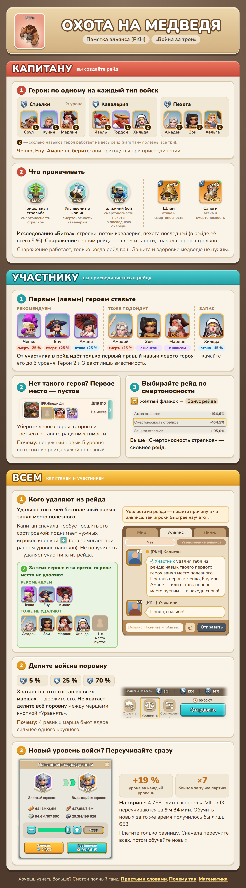

# Охота на медведя: памятка

**Гайды:** [Главная](../README.md) · Памятка (вы здесь) · [Простыми словами](../02-prostymi-slovami/guide.md) · [Почему так](../03-pochemu-tak/guide.md) · [Математика](../04-matematika/guide.md)

**Скачать:** [картинкой (PNG)](../download/Медведь_01_Памятка.png) · [PDF](../download/Медведь_01_Памятка.pdf)

## Всем

- **Навыки героев качайте до 5 уровня.** Где: герой → «Навыки» → правая колонка (флажок). Джойнеру лучше всего Ченко, Ёну (смертоносность +25 %) и Амане (атака +25 %); тоже подойдут Амадей (смертоносность +25 %), Зои и Марлин («с шансом»); запасной вариант Хильда (атака всего +15 %). Почему: каждый уровень добавляет всему рейду +5 %.
- **Все войска до топового уровня.** Сначала переучите низкие уровни, потом обучайте новых. Почему: уровень выше даёт +19 % урона, а переучиваются бойцы в 7 раз быстрее, чем обучаются новые.
- **Отправки равные, без остатка.** Состав: 5 % пехоты, 25 % кавалерии, остальное стрелки. Войск мало: просто поровну («Уравнять»). Почему: четыре равные отправки бьют вдвое сильнее одной.

## Капитан

1. **Герои рейда: по одному на тип.** Стрелки: Соул, Куинн, Марлин. Кавалерия: Явель, Гордон, Хильда. Пехота: Зои, Амадей, Хельга. Ченко, Ёну, Амане не брать: они нужны джойнерам. Хильду капитану можно (в расчёт идёт её +15 % атаки), а джойнеру она слабее. Амадей лучше всего у капитана (работают все три навыка); если пехоту лучше закрывает другой герой, отдайте Амадея джойнеру. На героев шлем и сапоги с атакой и смертоносностью. Почему: их навыки (+25 % или «с шансом») работают на весь рейд, а стрелки дают две трети урона.
2. **Проверка:** жёлтый флажок → «Бонус рейда». Таблицу (смертоносность стрелков) и навыки смотрите отдельно: навыки в таблице не видны. «Участники рейда» → «Навыки героя»: места берут по уровню навыка (5, потом 4…), при равном уровне выше тот, кто выше в списке.
3. **⬆ Поднимайте нужных игроков.** Строку игрока раскройте стрелкой справа и нажмите ⬆ (только капитан). Работает среди навыков того же уровня.
4. **✖ Бесполезный навык 5 уровня занял место полезного 4 уровня?** Удалите игрока из рейда и напишите об этом в чат альянса: так игроки быстрее научатся.

## Джойнер

1. **Найти лучший рейд:** жёлтый флажок → «Бонус рейда» → «Смертоносность стрелков»: чем выше, тем лучше (потом атака стрелков и навыки капитана). Четыре места уже заняты полезными пятёрками? Идите в другой.
2. **Первым (левым) героем: Ченко, Ёну или Амане; тоже подойдут Амадей, Зои, Марлин; запасной вариант Хильда.** Идёт только первый правый навык первого героя. В рейде уже много навыков атаки: берите Ченко, Ёну или Амадея. Много смертоносности: Амане. Никого из них нет: Зои или Марлин (навык «с шансом»: в среднем как Хильда, но в отдельном рейде на 6–9 % больше или меньше), затем Хильда.
3. **Нет полезного героя: первое место оставьте пустым.** Героев 2 и 3 оставьте: от их уровня растёт вместимость марша, берите самых высоких. Запасной вариант: герой с самым низким уровнем первого правого навыка.
4. **Увидели в чате, что вас удалили?** Качайте Ченко, Ёну, Амане (или Амадея) до 5 уровня и заходите снова.
