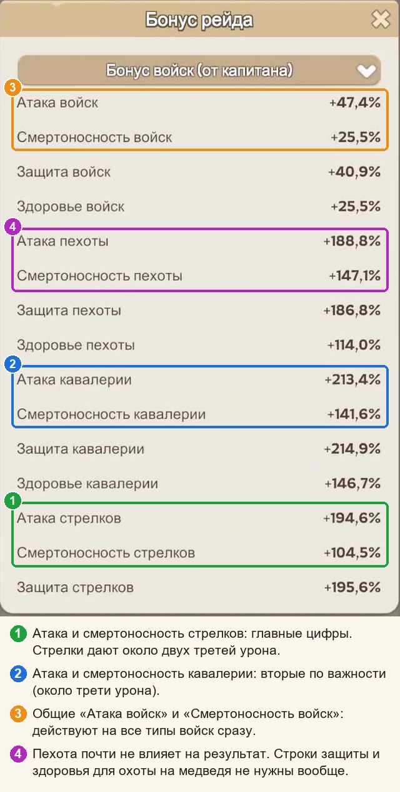
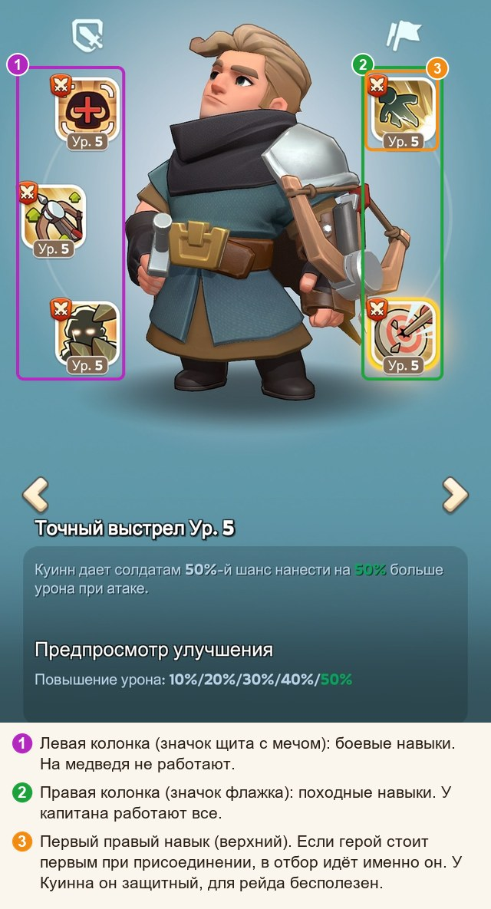
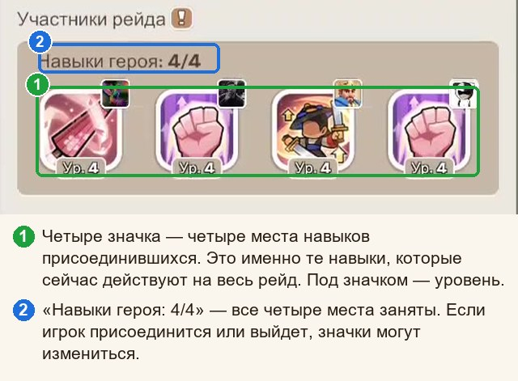

# Охота на медведя: памятка

**Гайды:** [Главная](../README.md) · Памятка (вы здесь) · [Простыми словами](../02-prostymi-slovami/guide.md) · [Почему так](../03-pochemu-tak/guide.md) · [Математика](../04-matematika/guide.md)

*Одна страница на случай «а как там было?». Хотите знать, почему именно так, — добро пожаловать в «Простыми словами».*

## Главное в пяти строках

1. Рейд усиливает **всех** участников сразу: цифры капитана, навыки его героев и четыре навыка присоединившихся.
2. Выбирайте рейд по таблице бонусов: чем выше **«Смертоносность стрелков»**, тем лучше ([почему](../03-pochemu-tak/guide.md#почему-рейды-сравнивают-по-смертоносности)).
3. Присоединяйтесь героем с полезным первым правым навыком (Ченко, Ёну, Амане, Хильда). Если такого нет, ставьте первым героя с **самым низким** уровнем первого правого навыка.
4. Армию делите на **равные отправки** и отправляйте, а не копите ([почему](../03-pochemu-tak/guide.md#почему-много-ударов-лучше-одного)).
5. Состав ([почему](../03-pochemu-tak/guide.md#почему-5--пехоты-и-25--кавалерии)): когда войск много, около **5 % пехоты, 25 % кавалерии**, остальное стрелки. Пока армия небольшая, проценты не нужны: просто делите всё поровну между отправками.

## Где смотреть рейд

В лобби рейда нажмите **жёлтый флажок** (1): откроется «Бонус рейда» с таблицей бонусов капитана, навыками его героев и четырьмя навыками присоединившихся.

## Как выбрать рейд

1. **Таблица «Бонус войск (от капитана)».** Смотрите на **«Смертоносность стрелков»** (рядом с ней общая «Смертоносность войск»): у капитанов она ниже атаки и сильнее всего скачет от рейда к рейду, поэтому сравнивать проще всего по ней. Число выше — рейд лучше. Если смертоносность почти одинаковая, посмотрите «Атаку стрелков», затем кавалерию. Пехоту, защиту и здоровье не смотрите.
2. **Навыки капитана.** Чем больше открытых походных навыков на атаку, смертоносность и повышение урона и чем выше их уровень, тем лучше.
3. **Четыре места присоединившихся.** Если в них слабые навыки, а вы приносите полезный, вы усилите рейд и себе, и всем остальным. Если там уже четыре полезных навыка 5 уровня, свой навык низкого уровня приберегите для другого рейда.
4. **Понравился капитан?** Нажмите звёздочку на карточке его рейда: рейды избранных капитанов показываются в списке сверху.

## Какого героя ставить, когда присоединяетесь

| Герой | Его первый правый навык | Прибавка на 5 уровне |
|---|---|---|
| Ченко | «Полная экипировка» | смертоносность +25 % |
| Ёну | «Готовность к бою» | смертоносность +25 % |
| Амане | «Тройная фаланга» | атака +25 % |
| Хильда | «Благородный путь» | атака +15 % |

- Этого героя ставьте **первым (левым)**. Уровень навыка любой, лишь бы навык был открыт и работал: чем выше уровень, тем больше шансов попасть в четвёрку.
- **Нужного героя нет?** Первым ставьте того, у кого **самый низкий уровень первого правого навыка** (карточка героя, вкладка «Навыки»): система его не выберет.
- **Какого из четырёх ставить.** Смотрите навыки капитана и четыре места присоединившихся: берите героя, чей вид бонуса там слабее. Атаки уже больше: ставьте Ченко или Ёну (смертоносность). Смертоносности больше: ставьте Амане (атака) ([почему](../03-pochemu-tak/guide.md#какой-набор-навыков-нужен-именно-этому-рейду)).
- Второй и третий герои для рейда ничего не дают. Если войск много, берите тех, при ком больше вместимость марша (число после косой черты на экране «Отправить»). Если войск мало, героев 2 и 3 можно не брать вообще.

## Как система выбирает четыре навыка присоединившихся

1. Берётся **первый правый навык первого героя** каждого присоединившегося.
2. Навыки **сортируются по уровню**, от 5 к 1.
3. **Верхние четыре** начинают работать на весь рейд.

Если уровни одинаковые, выше окажется тот, кто зашёл в рейд раньше ([подробнее](../03-pochemu-tak/guide.md#четыре-места-присоединившихся-и-почему-важно-кого-поставить)). Навык 5 уровня занимает место, пока игрок в рейде. Решает уровень, а не польза: система читает цифры, а не описания, поэтому бесполезный навык 5 уровня вытеснит полезный 4 уровня.

На картинке слева боевые навыки (на медведя не работают), справа походные; первый правый навык отмечен оранжевой рамкой.

## Состав и отправки

- **Пока армия небольшая** (на состав по процентам не хватает), процентов не делайте: просто делите всё поровну между отправками. Поможет кнопка **«Уравнять»** на экране отправки (слева внизу).
- **Когда войск много:** пехота 2–5 %, кавалерия около 25 %, остальное стрелки. Если бонусы кавалерии у капитана заметно слабее, чем у стрелков, берите кавалерии 15 %; если сильнее, 35–40 %. Одни стрелки: теряете около 15 %. В каждой отправке держите один и тот же состав.
- Чем больше равных отправок, тем лучше: четыре равные отправки бьют вдвое сильнее, чем та же армия одним ударом ([почему](../03-pochemu-tak/guide.md#почему-много-ударов-лучше-одного)).
- Берите войска самого высокого уровня; небольшая примесь слабого уровня почти не вредит.

## Если вы капитан

- Героев рейда выбирайте по таблице, а не по симпатии: поставили, открыли «Бонус рейда», сравнили. Навыки героев в таблице **не отображаются** и с её цифрами не складываются (это отдельный множитель), смотрите их в блоке навыков. Если проседает смертоносность, берите героя, который прибавляет её сильнее; если атака, берите героя с большей атакой. Важнее всего герой стрелков, затем кавалерии, затем пехоты. Порядок героев не важен. Для Соула есть эксклюзивное снаряжение «Кроличья пушка» (до +50 % смертоносности стрелков): критерии выбора героя и пример Соула с Куинном смотрите [здесь](../03-pochemu-tak/guide.md#как-выбрать-героя-капитана).
- Ченко, Ёну, Амане и Хильду лучше беречь для присоединения. Героев без полезных навыков (Диана, Олив, Говард, Фад, Сет, Форрест, Эдвин, все синие) в свой рейд не берите.
- Походные навыки героев на атаку, смертоносность и повышение урона («с шансом») качайте до 5 уровня.
- На героев своего рейда наденьте **лучшее снаряжение на атаку и смертоносность (шлем и сапоги)**. Оно действует, только когда рейд создаёте вы.
- Смотрите «Участники рейда → Навыки героя». Если бесполезный навык высокого уровня вытеснил полезный, удалите такого игрока из рейда.

## Прокачка по порядку

1. **Если присоединяетесь к чужим рейдам:** выберите одного героя из Ченко, Ёну, Амане, Хильды и доведите его первый правый навык до 5 уровня (одного героя достаточно). Затем качайте следующего из списка. Отправлять их вместе не нужно: в рейд идёт только первый герой.
2. **Если вы капитан:** походные навыки героев рейда на атаку и смертоносность до 5 уровня, затем на повышение урона («с шансом»).
3. Все войска переведите на **самый высокий доступный уровень** и только потом обучайте новых ([почему](../03-pochemu-tak/guide.md#почему-переучивать-выгоднее-чем-набирать)).
4. Исследования: атака и смертоносность стрелков, затем кавалерии, пехота последней. Подтягивайте то, что меньше (атаку или смертоносность).
5. Снаряжение героев на атаку и смертоносность: **шлем и сапоги**.

## Что не нужно

Защита и здоровье: медведь всё равно не отвечает. Блок «Завоевание» у героя. Порядок героев у капитана: не важен. Уровень и звёзды героя при присоединении (важен только уровень навыка). Пехота сверх 5–10 %.
