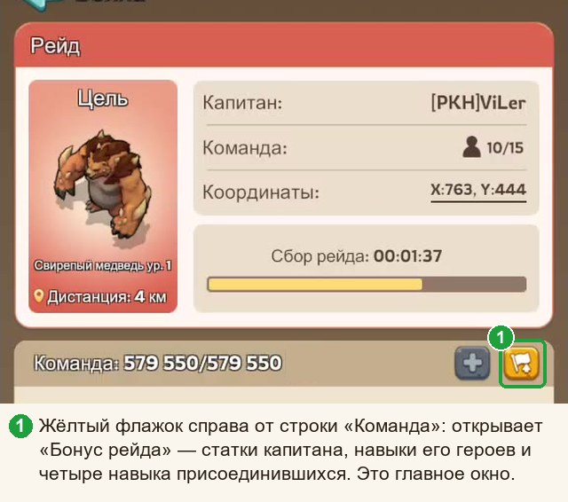
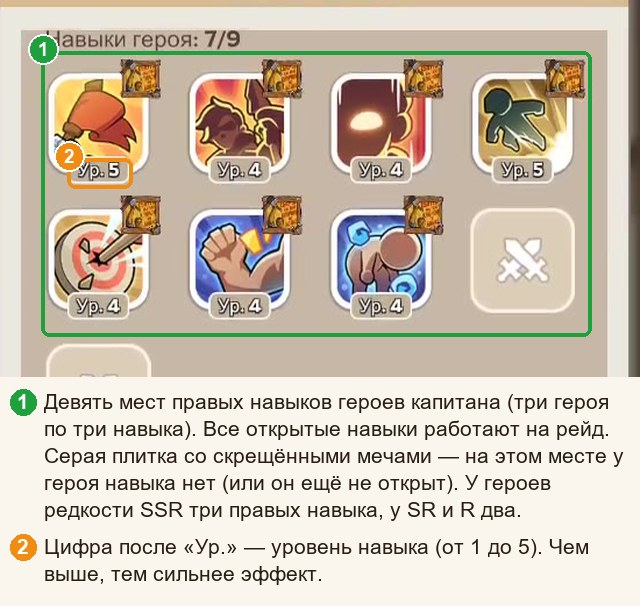
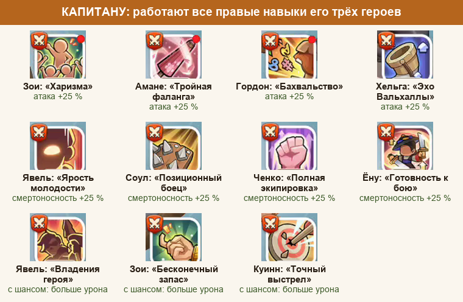
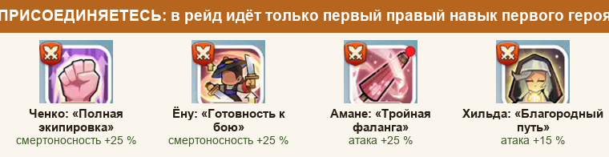
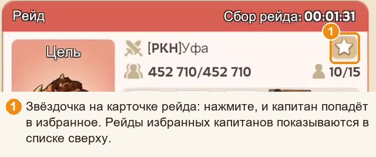
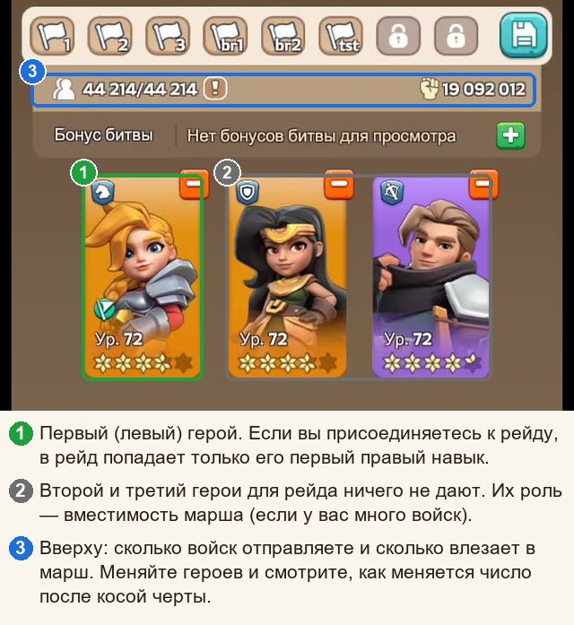
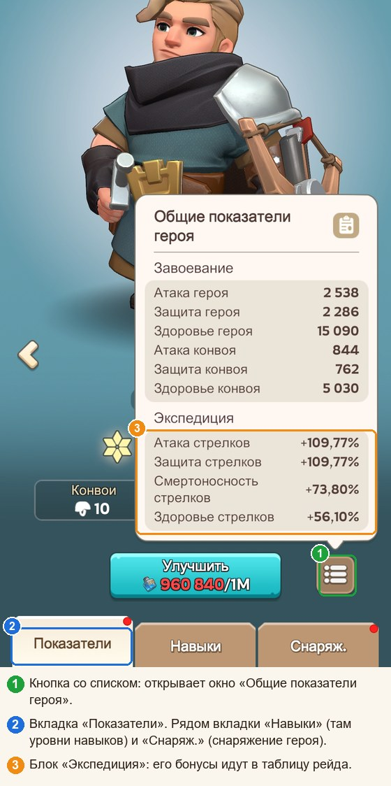
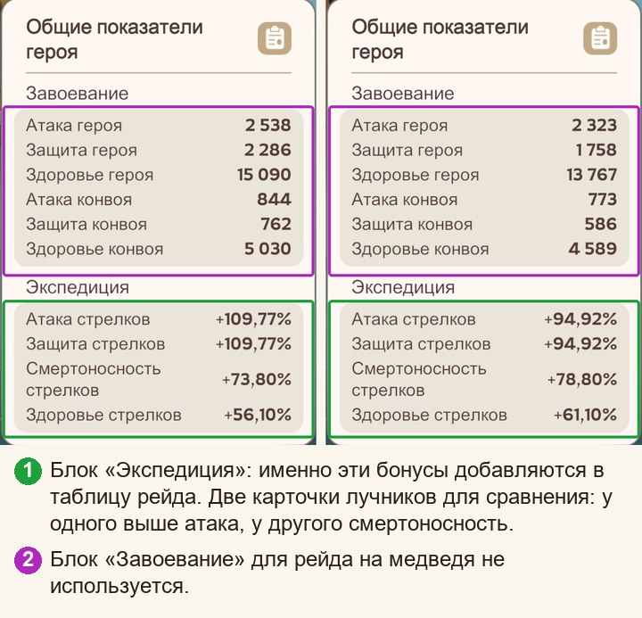

# Охота на медведя простыми словами

**Гайды:** [Памятка](../01-pamyatka/guide.md) · Простыми словами (вы здесь)

*Без формул и учёных слов. Зато с картинками, стрелочками и редкими шутками. Если нужна только шпаргалка, откройте «Памятку»; если хочется понять, почему именно так, — вы на месте.*

## Для начала: что за зверь этот медведь

Медведь — идеальный соперник: стоит, молчит, не отвечает и не жалуется в чат. Ваши войска не погибают, ничем не рискуют. Остаются только очки, и весь вопрос в том, **как набрать их побольше**.

Хорошая новость: ответ складывается из нескольких простых привычек. Плохая: привычки придётся завести, а не только прочитать про них.

## Откуда берётся урон

У каждого участника свой счёт, но считается он из двух половинок:

- **Ваша армия.** Сколько войск, какого типа и какого уровня.
- **Усилитель рейда.** Он один на всех участников, как мегафон на площади: чем мощнее, тем дальше слышно. Собирается из трёх источников:
  1. **цифры капитана** («Бонус рейда» с процентами атаки и смертоносности);
  2. **навыки героев капитана** (его правые навыки работают на весь рейд);
  3. **четыре навыка присоединившихся** (о них отдельный разговор ниже, это самое интересное).

Отсюда первое правило: **оценивайте рейд по усилителю, а не по громкости имени капитана.** Рейд скромного капитана с мощными цифрами лучше, чем рейд громкого имени с жидкими.

> **Что на урон по медведю не влияет.** Защита и здоровье (медведь не отвечает, защищаться не от кого). Блок «Завоевание» в карточке героя. Порядок героев у капитана. Сам герой в бою ничего не делает: он нужен ради навыков и ради вместимости. Качать защиту и здоровье стоит для арены и других дел, но для медведя они бесполезны, как зонтик в пустыне.

## Закон «много ударов лучше одного»

Это главная особенность медведя. Если отправить всю армию одним маршем, каждая следующая тысяча солдат в той же куче добавляет всё меньше урона. А если разбить армию на несколько равных отправок, **каждая начинает почти с нуля**.

| На сколько равных отправок разбита одна и та же армия | Урон относительно одного удара |
|---|---|
| одна | 100 % |
| две | около 140 % |
| три | около 175 % |
| четыре | 200 % |
| пять | около 225 % |
| шесть | около 245 % |

Вывод в одну строку: **отправляйте всё и делите на равные части.** Копить армию «на потом» — это как не ходить в магазин, пока не накопится на целый холодильник.

> **Оговорка.** Таблица верна, если рейды, в которые вы отправляете, примерно одинаковой силы. Если один рейд заметно сильнее другого, отправьте в сильный побольше.

## Куда нажимать, чтобы увидеть всю правду о рейде

Откройте любой рейд в списке. Перед вами лобби: капитан, время сбора, участники.

Нужен **жёлтый флажок** (1). Он открывает окно **«Бонус рейда»**, из которого про рейд можно узнать почти всё. В нём три полезных места: таблица с процентами, блок навыков героев капитана и блок «Участники рейда» с четырьмя навыками присоединившихся. Разбираем по очереди.

## Таблица: читаем проценты

Строк много, но важны не все.

- **Атака стрелков** и **Смертоносность стрелков**: главные цифры. Стрелки дают две трети урона.
- **Атака кавалерии** и **Смертоносность кавалерии**: вторые по важности, около трети урона.
- **Атака войск** и **Смертоносность войск** (общие строки) действуют на все типы войск сразу.
- Пехота даёт совсем немного, а защита и здоровье для медведя не нужны вообще.

### Атака и смертоносность работают в паре

Это неожиданно, но атака и смертоносность не просто складываются: они **перемножаются**, как две стороны прямоугольника. Площадь (то есть урон) растёт, когда подтягивается любая сторона, но выгоднее подтягивать **короткую**.

> **Пример.** Рейд А: атака 230 %, смертоносность 70 %. Рейд Б: по 150 %. Суммы одинаковы (300 и 300), а по урону рейд Б сильнее примерно на 10 %: прямоугольник ближе к квадрату. Ровные цифры лучше перекошенных.

### Как сравнить два рейда, не доставая калькулятор

Хорошая новость: считать ничего не нужно. У большинства капитанов атака примерно одинакова, а вот **смертоносность отличается в разы**. Она и делает разницу. Поэтому **сравнивайте рейды по «Смертоносности стрелков»** (при желании прибавьте общую «Смертоносность войск»). В проверке на тридцати разных таблицах порядок рейдов по этому числу почти всегда совпал с точным расчётом.

Если смертоносность почти одинаковая, посмотрите «Атаку стрелков», затем кавалерию. Если разница меньше 10 %, считайте ничьей и берите любой: у вас найдутся дела поважнее.

## Навыки героев капитана

У капитана три героя и по несколько **правых** навыков у каждого. У героев редкости SSR их три, у SR и R два, так что мест бывает меньше девяти. Все открытые навыки работают на весь рейд. Левые («боевые») на медведя не действуют, так что не удивляйтесь, если «мощный навык» из описания героя не прибавил ни очка.

Под каждым значком стоит **уровень навыка** (от 1 до 5). Чем выше, тем сильнее прибавка: у навыков на атаку и смертоносность это обычно +5 % за уровень, то есть +25 % на пятом (у Хильды +3 % за уровень).

Полезные навыки **капитана** выглядят так:

- **Атака** (+25 % на 5 уровне): Зои «Харизма», Амане «Тройная фаланга», Гордон «Бахвальство», Хельга «Эхо Вальхаллы».
- **Смертоносность** (+25 % на 5 уровне): Явель «Ярость молодости», Соул «Позиционный боец», Ченко «Полная экипировка», Ёну «Готовность к бою».
- **Повышение урона «с шансом»** (Явель, Зои, Куинн): срабатывают не всегда, но в среднем заметно прибавляют; прокачивайте их до 5 уровня.

Остальные навыки (защита, здоровье, хозяйство) для медведя бесполезны. Значок есть, прибавки нет.

## Четыре навыка присоединившихся: как их выбирает система

Вот то самое интересное. В рейде есть **четыре места** для навыков присоединившихся игроков. Что в них окажется, решает система **по строгому правилу**, и это правило полезно знать наизусть.

> **Правило отбора.**
> 1. Из каждого присоединившегося берётся **первый правый навык первого (левого) героя**. Остальные герои и навыки в расчёт не идут.
> 2. Все собранные навыки **сортируются по уровню**: пятые, затем четвёртые, и так далее.
> 3. **Верхние четыре** начинают усиливать весь рейд.
>
> Если у навыков одинаковый уровень, выше окажется тот, кто зашёл в рейд раньше (судя по всему).

Из этого правила следуют вещи, которые не очевидны.

**Решает уровень, а не польза.** Система слепа к смыслу навыка: ей важен номер уровня, как в лотерее. Поэтому бесполезный навык 5 уровня (например, защитный) **вытесняет** полезный навык 4 уровня. Вот почему полезно, чтобы нужный навык был прокачан как можно выше.

**Пятый уровень закрепляется.** Пока игрок в рейде, его навык 5 уровня удерживает место: позже зашедшие его не вытеснят.

**Поставили первым защитного героя 5 уровня?** Поздравляем, вы только что бесплатно выдали рейду место для бесполезного навыка. Капитан оценит. Недолго.

**Если полезного героя нет.** Тогда первым поставьте того, у кого **самый низкий уровень первого правого навыка** (смотрите в карточке героя, вкладка «Навыки»): система его не выберет, и он не займёт чужое место. Заодно запомните, зачем вообще нужны герои в отправке: без героя в марш влезет меньше войск (вместимость). **Если армия небольшая, героев можно не брать вообще**: вместимость вам не мешает.

### Какие навыки присоединившегося полезны

Полезны только четыре первых правых навыка:

- **Ченко** и **Ёну**: смертоносность +25 % всему рейду.
- **Амане**: атака +25 % всему рейду.
- **Хильда**: атака +15 % (слабее, но лучше, чем ничего).

У остальных героев первый правый навык на урон по медведю не влияет (защита, здоровье, хозяйство, шанс). Ставьте их первым только по правилу «самый низкий уровень».

### Что даёт заполненная четвёрка

Прибавка действует на **весь** рейд, и на вас в том числе. В таблице: все навыки 5 уровня, капитан с обычным набором (по одному навыку на атаку и смертоносность).

| Что стоит в четырёх местах | Урон рейда вырастает в |
|---|---|
| ни одного полезного навыка | 1,0 раза |
| один Ченко (или Ёну) | 1,2 раза |
| одна Хильда | 1,1 раза |
| два Ченко/Ёну | 1,4 раза |
| один Ченко и один Амане | 1,45 раза |
| три Ченко/Ёну | 1,6 раза |
| четыре Ченко/Ёну | 1,8 раза |
| два Ченко/Ёну, Амане и Хильда | 1,85 раза |
| **два Ченко/Ёну и два Амане** | **1,96 раза (лучший вариант)** |
| то же, но все навыки только 4 уровня | 1,74 раза |

Какой вывод? **Две смертоносности и две атаки лучше, чем четыре одинаковых**: они прибавляются в разные «стороны прямоугольника». И видно, что недокачанный до 5 уровня навык стоит около 10 % прибавки: дешёвое улучшение, которое даёт очки всему альянсу.

## Как выбрать рейд (без ников и знакомств)

Алгоритм на три шага, работает с любым капитаном:

1. **Откройте «Бонус рейда» и сравните таблицы** по «Смертоносности стрелков» (см. выше). Кто выше, тот лучше.
2. **Посмотрите на навыки капитана.** Чем больше полезных навыков на высоком уровне, тем лучше.
3. **Посмотрите на четыре места присоединившихся.** Если там слабые навыки, а у вас есть полезный, ваш приход подтянет рейд. Если там уже стоят четыре полезных навыка 5 уровня, **не тратьте свой полезный навык низкого уровня на этот рейд**: он здесь ничего не изменит. Приберегите его для другого рейда, где места ещё есть. Усилителем рейда вы в любом случае воспользуетесь.

Нашли капитана, к которому хочется возвращаться? Нажмите **звёздочку** на карточке рейда в списке: рейды избранных капитанов показываются сверху.

## Какой состав войск взять

Войска делятся на три типа: пехота, кавалерия, стрелки. Каждый тип считается отдельно, и у каждого своя «отдача»: стрелки самые сильные, кавалерия примерно вдвое слабее, пехота ещё слабее.

### Сначала разделите на отправки, потом думайте о составе

Это два разных шага:

1. **Разбейте армию на равные отправки** (по числу ваших маршей).
2. **Внутри каждой отправки** держите один и тот же состав.

**Пока армия небольшая** и на состав по процентам не хватает, второй шаг пропустите: никаких процентов, просто разделите всё, что есть, поровну между отправками.

### Когда войск много

- **Пехота:** 2–5 %. Нуль невыгоден (теряете около 3 %), а свыше 10 % уже начинаете терять.
- **Кавалерия:** около 25 %. Если у капитана кавалерия заметно слабее стрелков: хватит 15 %. Заметно сильнее: до 35–40 %.
- **Стрелки:** всё остальное.

Не гонитесь за точностью. Ошибка в 10 процентных пунктов в кавалерии стоит около 1 %. А вот совсем отказаться от кавалерии и пехоты дорого: около 15 % урона.

Про уровни войск запомните так: берите самые высокие, а слабые добавляйте, если без них не хватает. Допустим, у вас 9 000 войск Т9 и 1 000 войск Т8. Отправка всех 10 000 даёт на 1,6 % меньше урона, чем 10 000 войск Т9, но заметно больше, чем только 9 000 войск Т9. Слабых бойцов лучше отправить, чем оставить дома.

## Какого героя ставить

### Если вы присоединяетесь

- **Первый (левый) герой:** Ченко, Ёну, Амане или Хильда. Уровень навыка любой, лишь бы он был открыт и работал: чем выше, тем больше шансов попасть в четвёрку. Нет такого героя? Тогда герой с самым низким первым правым навыком.
- **Второй и третий герои:** для рейда они ничего не дают. Они нужны, чтобы у вас **влезало больше войск** (вместимость). Если войск мало, героев 2 и 3 можно не брать. Если много: меняйте героев и смотрите на число после косой черты вверху экрана «Отправить», берите тех, при которых оно больше.

### Если вы капитан

Герои делятся по типам войск, и в рейде нужен **по одному на тип**: пехота, кавалерия, стрелки.

- **Стрелки** (Куинн, Соул, Ёну, Амане, Олив): самый важный герой, потому что стрелки дают две трети урона.
- **Кавалерия** (Явель, Ченко, Гордон, Эдвин, Фад, Хильда): второй по важности.
- **Пехота** (Зои, Говард, Хельга, Сет, Форрест): самая скромная роль.

От героя берутся **походные бонусы**: блок «Экспедиция» в его карточке (процент атаки и смертоносности вашего типа войск) и его правые навыки. Откуда этот блок берётся? Откройте карточку героя и нажмите кнопку со списком (1):

Вот как выглядит блок «Экспедиция» вблизи у двух героев-стрелков (блок «Завоевание» для медведя не нужен):

Выбирайте героя по результату: поставили, открыли «Бонус рейда», посмотрели на строки стрелков или кавалерии. Лучше тот, при котором итоговые цифры выше. Проверить можно за минуту. У двух героев на картинке разные сильные стороны: у одного выше атака, у другого смертоносность. Кто победит, зависит от остальных цифр рейда, и угадывать бессмысленно, проще проверить.

Ещё полезно знать: у **Куинна** навык «с шансом», у **Соула** навык +25 % смертоносности.

**Порядок героев у капитана не важен**: хоть слева направо, хоть наоборот, результат тот же.

### Кого не стоит брать вообще

**Присоединяясь**, не ставьте первыми героев с высокими защитными навыками: они вытеснят полезные. Это Явель, Куинн, Говард, Гордон, Соул, Хельга, Фад, Зои, Форрест, Олив, Эдвин, Сет. Ставить их можно на второе и третье места ради вместимости, и тогда они совершенно безобидны.

**Капитану** не стоит брать:

- героев редкости **R (синих)**: у них мало навыков;
- героев, у которых **нет полезных навыков** (ни атаки, ни смертоносности, ни повышения урона): Говард, Фад, Сет, Форрест, Олив, Эдвин. Их бонусы к типу войск могут быть неплохими, но навыки рейду ничего не добавят.

## Снаряжение

Герои тоже одеваются, и снаряжение даёт бафы к атаке и смертоносности. Правила:

- **На героев своего рейда** наденьте лучшее снаряжение на атаку и смертоносность: **шлем и сапоги**.
- Работает оно **только когда рейд создаёте вы**. При присоединении к чужому рейду снаряжение вашего героя рейду ничего не даёт. Но на другие задачи (арена, походы) героев одевайте как обычно.

## Что качать и в каком порядке

Если ресурсов мало, вот порядок:

1. **Присоединяетесь к чужим рейдам:** выберите одного героя из Ченко, Ёну, Амане, Хильды и доведите его первый правый навык до 5 уровня. Одного героя достаточно. Потом качайте следующего из списка. Отправлять их вместе не нужно: в рейд идёт только первый герой.
2. **Вы капитан:** навыки героев рейда на атаку и смертоносность до 5 уровня, затем навыки повышения урона «с шансом».
3. **Войска:** сначала переучите всех на **Т9**, только потом обучайте новых. Переобучение с Т8 на Т9 не прибавляет солдат, но делает каждого сильнее на 18–20 %: для всей армии это по эффекту как прибавка около 40 % войск. А за одно обучение той же длительности на Т9 переходит больше воинов, чем обучается новых.
4. **Исследования:** атака и смертоносность стрелков, затем кавалерии, пехота в последнюю очередь. Защита и здоровье для медведя не нужны. Подтягивайте то, что меньше: атаку или смертоносность, они же перемножаются.
5. **Снаряжение героев:** на атаку и смертоносность (шлем и сапоги). Сначала для героя стрелков, потом кавалерии.

## Советы капитанам

- **Заглядывайте в «Участники рейда → Навыки героя».** Если среди четырёх навыков затесался бесполезный пятого уровня, он вытеснил полезный четвёртого. Такого игрока можно удалить из рейда, и место освободится.
- **Просите заходить с нужными героями** и напоминайте про правило первого героя: игроки не обязаны знать его сами.
- **Следите за уровнем навыков своих героев.** Навык на 4 уровне вместо 5 отнимает около 5 % у всех, и у вас в том числе.
- **Снаряжение** на героев рейда: лучшее на атаку и смертоносность (шлем и сапоги).

## Частые ошибки (смотрите и не повторяйте)

- **Отправить всю армию одним маршем.** Вместо 245 % получаете 100 %: при шести отправках разница в два с половиной раза. Копилка для войск — не лучшая идея.
- **Поставить первым защитного героя 5 уровня.** Он займёт место полезного навыка. Все очень расстроятся, особенно вы.
- **Отправлять одних стрелков.** Кажется логичным, теряете 15 %.
- **Качать защиту и здоровье «на всякий случай» для медведя.** Медведю всё равно, он даже не заметит.
- **Выбирать рейд по ощущениям.** Интуиция хороша в других делах, а в рейдах пять секунд на таблицу скажут больше любой интуиции.
- **Обучать новых солдат, пока часть армии не доведена до Т9.** Это дороже и хуже.

## Мини-словарь

- **Атака / смертоносность:** два бонуса, которые увеличивают урон войск. Они перемножаются.
- **Усилитель рейда:** цифры капитана + навыки его героев + четыре навыка присоединившихся.
- **Правый навык:** навык, который работает в рейде. Левые боевые на медведя не действуют.
- **Первый герой:** левый герой в вашей отправке. При присоединении именно его первый правый навык попадает в отбор.
- **Места навыков:** четыре места для навыков присоединившихся; занимают их навыки с самым высоким уровнем.
- **Вместимость:** сколько войск влезает в марш; растёт от героев и от уровня командного центра (прокачивается после посольства).
