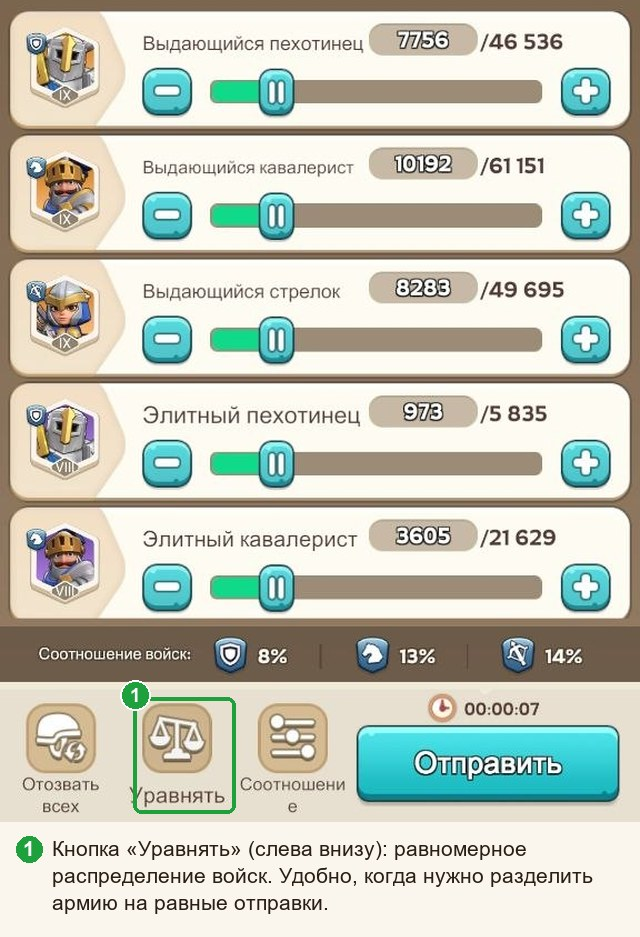
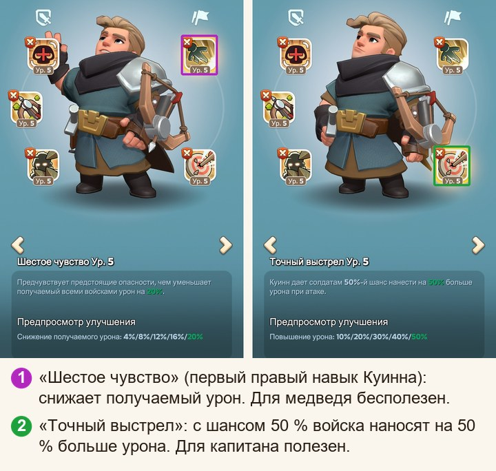
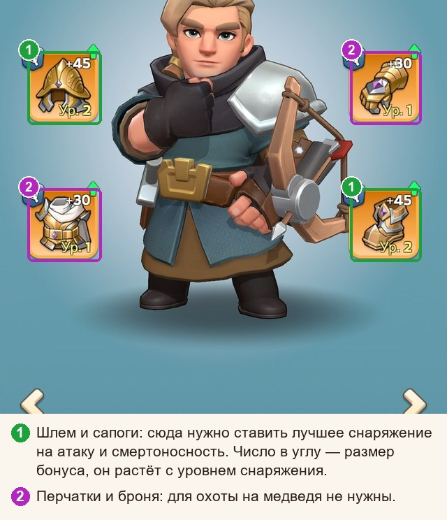

# Охота на медведя простыми словами

**Гайды:** [Главная](../README.md) · [Памятка](../01-pamyatka/guide.md) · Простыми словами (вы здесь) · [Почему так](../03-pochemu-tak/guide.md) · [Математика](../04-matematika/guide.md)

*Без формул и учёных слов, зато с картинками, стрелочками и шутками, которые медведь всё равно не оценит. Нужна только шпаргалка — вам в «Памятку»; хочется понять, почему именно так, — вы по адресу.*

## Для начала: что за зверь этот медведь

Медведь — соперник мечты: стоит, молчит, сдачи не даёт, не пишет капслоком в общий чат и не требует объяснить, кто тут главный. Ваши войска не погибают и ничем не рискуют, так что геройствовать можно на полную. Остаются только очки, и весь вопрос в том, **как набрать их побольше**.

Хорошая новость: ответ складывается из нескольких простых привычек. Плохая: привычки придётся завести, а одного чтения про них, увы, мало. Прочитанный и закрытый гайд урона медведю не наносит.

## Откуда берётся урон

У каждого участника свой счёт, но считается он из двух половинок:

- **Ваша армия.** Сколько войск, какого типа и какого уровня.
- **Усилитель рейда.** Он один на всех участников, как мегафон на площади: чем мощнее, тем дальше слышно. Собирается из трёх источников:
  1. **цифры капитана** («Бонус рейда» с процентами атаки и смертоносности);
  2. **навыки героев капитана** (его походные навыки работают на весь рейд);
  3. **четыре навыка присоединившихся** (о них отдельный разговор ниже, это самое интересное).

Отсюда первое правило: **оценивайте рейд по усилителю.** Армия у вас везде одна и та же, а вот мегафон у каждого рейда свой (у одного это стадионные колонки, у другого пищалка из коробки с хлопьями), и именно он решает, сколько очков вы унесёте домой.

> **Что на урон по медведю не влияет.** Защита и здоровье: медведь не отвечает, защищаться не от кого. Блок «Завоевание» в карточке героя. Порядок героев у капитана. Сам герой в бою меча не поднимает: он нужен ради навыков и ради вместимости. Для арены и других дел защиту и здоровье качать стоит, но на очки по медведю они не влияют вообще.

## Закон «много ударов лучше одного»

Это главная особенность медведя. Если отправить всю армию одним маршем, каждая следующая тысяча солдат толкается в той же куче и добавляет всё меньше урона. А если разбить армию на несколько равных отправок, **каждая начинает почти с нуля**. Это как очередь в одну кассу: сколько покупателей ни ставь, кассир быстрее пробивать не станет. Откройте ещё несколько касс, и дело пойдёт.

| На сколько равных отправок разбита одна и та же армия | Урон относительно одного удара |
|---|---|
| одна | 100 % |
| две | около 140 % |
| три | около 175 % |
| четыре | 200 % |
| пять | около 225 % |
| шесть | около 245 % |

Вывод в одну строку: **отправляйте всё и делите на равные части.** Копить армию «на потом» — это как не ходить в магазин, пока не накопится на целый холодильник. Пока копите, ивент заканчивается, а холодильник так и стоит пустой.

> **Оговорка.** Таблица верна, если рейды, в которые вы отправляете, примерно одинаковой силы. Если один рейд заметно сильнее другого, отправьте в сильный побольше.

**Как разбить армию на равные части.** На экране отправки есть кнопка **«Уравнять»** (слева внизу): она помогает распределить войска равномерно.

## Куда нажимать, чтобы увидеть всю правду о рейде

Откройте любой рейд в списке. Перед вами лобби: капитан, время сбора, участники.

Нужен **жёлтый флажок** (1). Он открывает окно **«Бонус рейда»**, своего рода медицинскую карту рейда: из неё можно узнать почти всё. В нём три полезных места: таблица с процентами, блок навыков героев капитана и блок «Участники рейда» с четырьмя навыками присоединившихся. Разбираем по очереди.

## Таблица: читаем проценты

Строк много, но важны не все: часть здесь явно для массовки. И ещё одно: **навыки героев в таблицу не входят**, она показывает только цифры капитана и [блоки «Экспедиция» его героев](#блок-экспедиция-в-карточке-героя). Навыки смотрите отдельно, в блоке навыков. Друг с другом они тоже не складываются: цифры таблицы и бонусы навыков перемножаются, как два отдельных множителя.

- **Атака стрелков** и **Смертоносность стрелков**: главные цифры. Стрелки дают две трети урона.
- **Атака кавалерии** и **Смертоносность кавалерии**: вторые по важности, около трети урона.
- **Атака войск** и **Смертоносность войск** (общие строки) действуют на все типы войск сразу.
- Пехота даёт совсем немного, а защита и здоровье для медведя не нужны вообще.

### Атака и смертоносность работают в паре

Это неожиданно, но атака и смертоносность не просто складываются: они **перемножаются**, как две стороны прямоугольника. Площадь (то есть урон) растёт, когда подтягивается любая сторона, но выгоднее подтягивать **короткую**.

> **Пример.** Рейд А: атака 230 %, смертоносность 70 %. Рейд Б: по 150 %. Суммы одинаковы (300 и 300), а по урону рейд Б сильнее примерно на 10 %: прямоугольник ближе к квадрату. Ровные цифры лучше перекошенных: у длинной узкой доски и квадратного стола периметр может быть одинаковым, но обедать почему-то удобнее за столом.

### Как сравнить два рейда, не доставая калькулятор

Считать ничего не нужно, калькулятор может отдыхать. У большинства капитанов атака примерно одинакова, а вот **смертоносность отличается в разы**. Она и делает разницу. Поэтому **сравнивайте рейды по «Смертоносности стрелков»** (при желании прибавьте общую «Смертоносность войск»). В проверке на тридцати разных таблицах порядок рейдов по этому числу почти всегда совпал с точным расчётом.

Если смертоносность почти одинаковая, посмотрите «Атаку стрелков», затем кавалерию. Если разница меньше 10 %, считайте ничьей и берите любой: у вас найдутся дела поважнее.

## Навыки героев капитана

У капитана три героя и по несколько **походных** навыков у каждого. У героев редкости SSR их три, у SR и R два, так что мест бывает меньше девяти. Все открытые походные навыки работают на весь рейд. «Боевые» навыки на медведя не действуют, так что не удивляйтесь, если «мощный навык» из описания героя не прибавил ни очка. Как отличить походные от боевых в карточке героя, показано на картинке в разделе [«Четыре навыка присоединившихся»](#четыре-навыка-присоединившихся-как-их-выбирает-система).

Под каждым значком стоит **уровень навыка** (от 1 до 5). Чем выше, тем сильнее прибавка: у навыков на атаку и смертоносность это обычно +5 % за уровень, то есть +25 % на пятом (у Хильды +3 % за уровень).

Полезные навыки **капитана** выглядят так:

- **Атака** (+25 % на 5 уровне): Зои «Харизма», Амане «Тройная фаланга», Гордон «Бахвальство», Хельга «Эхо Вальхаллы».
- **Смертоносность** (+25 % на 5 уровне): Явель «Ярость молодости», Соул «Позиционный боец», Ченко «Полная экипировка», Ёну «Готовность к бою».
- **Повышение урона «с шансом»** (Явель, Зои, Куинн, а у кого открыт, ещё и Марлин): срабатывают не всегда, но в среднем заметно прибавляют; несколько таких навыков складываются между собой; прокачивайте их до 5 уровня.

Остальные навыки (защита, здоровье, хозяйство, энергия, скорость марша) для медведя бесполезны. Значок есть, прибавки нет: чистая бижутерия.

## Четыре навыка присоединившихся: как их выбирает система

А вот и обещанное самое интересное. В рейде есть **четыре места** для навыков присоединившихся игроков. Что в них окажется, решает система **по строгому правилу**, и это правило полезно знать наизусть.

> **Правило отбора.**
> 1. Из каждого присоединившегося берётся **первый правый (походный) навык первого (левого) героя**. Остальные герои и навыки в расчёт не идут.
> 2. Все собранные навыки **сортируются по уровню**: пятые, затем четвёртые, и так далее.
> 3. **Верхние четыре** начинают усиливать весь рейд.
>
> Если у навыков одинаковый уровень, выше окажется тот, кто зашёл в рейд раньше (судя по всему).

Фраза «первый правый навык первого героя» звучит как скороговорка, поэтому смотрите на картинку: так выглядит вкладка «Навыки» в карточке героя.

Слева стоят боевые навыки (на медведя не работают), справа походные. Из правой колонки в отбор идёт **верхний** навык, и только если герой стоит в отправке **первым**. Здесь это защитный навык Куинна: полезным его не назовёт даже самый преданный поклонник Куинна.

Из правила следуют вещи, которые не очевидны.

**Решает уровень, а не польза.** Система смотрит на навык, как охранник на пропуск: цифру уровня видит, а что навык умеет, её не волнует. Поэтому бесполезный навык 5 уровня (например, защитный) **вытесняет** полезный навык 4 уровня. Вот почему полезно, чтобы нужный навык был прокачан как можно выше.

**Пятый уровень закрепляется.** Пока игрок в рейде, его навык 5 уровня удерживает место: позже зашедшие его не вытеснят. Как полотенце на шезлонге у бассейна: занято, и точка.

**Поставили первым защитного героя 5 уровня?** Поздравляем, вы только что бесплатно выдали рейду место для бесполезного навыка: теперь рейд надёжно защищён от зверя, который не бьёт в ответ. Капитан оценит. Недолго.

**Если полезного героя нет.** Тогда первым поставьте того, у кого **самый низкий уровень первого правого навыка** (смотрите в карточке героя, вкладка «Навыки»): система его не выберет, и он не займёт чужое место. Заодно запомните, зачем вообще нужны герои в отправке: без героя в марш влезет меньше войск (вместимость). **Если армия небольшая, героев можно не брать вообще**: ограничение вместимости вам не помешает.

### Какие навыки присоединившегося полезны

Полезны только четыре первых правых навыка:

- **Ченко** и **Ёну**: смертоносность +25 % всему рейду.
- **Амане**: атака +25 % всему рейду.
- **Хильда**: атака +15 % (слабее, но лучше, чем ничего).

У остальных героев первый правый навык на урон по медведю не влияет (защита, здоровье, хозяйство, шанс). Ставьте их первым только по правилу «самый низкий уровень».

### Что даёт заполненная четвёрка

Прибавка действует на **весь** рейд, и на вас в том числе. В таблице: все навыки 5 уровня, капитан с обычным набором (по одному навыку на атаку и смертоносность).

| Что стоит в четырёх местах | Урон рейда вырастает в |
|---|---|
| ни одного полезного навыка | 1,0 раза |
| одна Ченко (или Ёну) | 1,2 раза |
| одна Хильда | 1,1 раза |
| две Ченко/Ёну | 1,4 раза |
| одна Ченко и одна Амане | 1,44 раза |
| три Ченко/Ёну | 1,6 раза |
| четыре Ченко/Ёну | 1,8 раза |
| две Ченко/Ёну, Амане и Хильда | 1,85 раза |
| **две Ченко/Ёну и две Амане** | **1,96 раза (лучший вариант при равных навыках капитана)** |
| то же, но все навыки только 4 уровня | 1,74 раза |

Какой вывод? **Две смертоносности и две атаки лучше, чем четыре одинаковых**: они прибавляются в разные «стороны прямоугольника». Но это при равных навыках у капитана. В общем случае добавляйте тот вид, где сумма навыков сейчас меньше (подробнее в «Почему так», раздел [«Какой набор навыков нужен именно этому рейду»](../03-pochemu-tak/guide.md#какой-набор-навыков-нужен-именно-этому-рейду)). И видно, что недокачанный до 5 уровня навык стоит около 10 % прибавки: дешёвое улучшение и редкий случай, когда ваша прокачка приносит очки всему альянсу.

## Как выбрать рейд (без ников и знакомств)

Алгоритм на три шага, работает с любым капитаном, даже незнакомым:

1. **Откройте «Бонус рейда» и сравните таблицы** по «Смертоносности стрелков» (подробнее: [«Как сравнить два рейда»](#как-сравнить-два-рейда-не-доставая-калькулятор)). Кто выше, тот лучше.
2. **Посмотрите на навыки капитана.** Чем больше полезных навыков на высоком уровне, тем лучше.
3. **Посмотрите на четыре места присоединившихся.** Если там слабые навыки, а у вас есть полезный, ваш приход подтянет рейд. Если там уже стоят четыре полезных навыка 5 уровня, **не тратьте свой полезный навык низкого уровня на этот рейд**: он здесь ничего не изменит. Приберегите его для другого рейда, где места ещё есть. Усилителем рейда вы в любом случае воспользуетесь.

Нашли капитана, к которому хочется возвращаться? Нажмите **звёздочку** на карточке рейда в списке: рейды избранных капитанов показываются сверху.

## Какой состав войск взять

Войска делятся на три типа: пехота, кавалерия, стрелки. Каждый тип считается отдельно, и у каждого своя «отдача»: стрелки самые сильные, кавалерия примерно вдвое слабее, пехота ещё слабее.

### Сначала разделите на отправки, потом думайте о составе

Это два разных шага:

1. **Разбейте армию на равные отправки** (по числу ваших маршей). В этом помогает кнопка «Уравнять» на экране отправки (см. картинку выше).
2. **Внутри каждой отправки** держите один и тот же состав.

**Пока армия небольшая** и на состав по процентам не хватает, второй шаг пропустите: никаких процентов, просто разделите всё, что есть, поровну между отправками.

### Когда войск много

- **Пехота:** 2–5 %. Нуль невыгоден (теряете около 3 %), а свыше 10 % уже начинаете терять.
- **Кавалерия:** около 25 %. Если у капитана кавалерия заметно слабее стрелков: хватит 15 %. Заметно сильнее: до 35–40 %.
- **Стрелки:** всё остальное.

Не гонитесь за точностью до последнего солдата. Ошибка в 10 процентных пунктов в кавалерии стоит около 1 %. А вот совсем отказаться от кавалерии и пехоты дорого: около 15 % урона.

Про уровни войск запомните так: берите самые высокие, а слабые добавляйте, если без них не хватает. Допустим, у вас 9 000 войск Т9 и 1 000 войск Т8. Отправка всех 10 000 даёт на 1,6 % меньше урона, чем 10 000 войск Т9, но заметно больше, чем только 9 000 войск Т9. Слабых бойцов лучше отправить, чем оставить скучать дома.

### Откуда взялись проценты состава

Стрелок, кавалерист и пехотинец бьют по медведю с разной отдачей. Во сколько раз, мы оценили тремя способами, и они сошлись по порядку (стрелок сильнее кавалериста, кавалерист сильнее пехотинца), а по размеру чуть расходятся:

| Откуда оценка | Стрелок | Кавалерист | Пехотинец | Лучший состав (пехота / кавалерия / стрелки) | Сколько теряет состав 5 / 25 / 70 |
|---|---|---|---|---|---|
| Наши измерения по настоящим рейдам (35 рейдов, 226 игроков) | 1,00 | 0,59 | 0,27 | 5 / 25 / 70 | 0 % |
| Публичный калькулятор урона по медведю | 1,00 | 0,62 | 0,21 | 3 / 27 / 70 | 0,1 % |
| Карточки войск (атака × смертоносность), стрелкам +10 % за «Дальний удар» | 1,00 | 0,78 | 0,40 | 9 / 34 / 57 | 1,1 % |

С настоящими рейдами лучше всего сходятся наши измерения (ошибка прогноза около 2 %, у калькулятора 2,3 %, у карточек 2,9 %), поэтому в гайдах стоят их числа. Почему точное отношение не совпало с карточкой, мы не знаем: формулу боя игра не показывает, а в карточке виден не весь набор того, что влияет на урон.

**Главное: какая бы из трёх оценок ни оказалась правдой, совет «около 5 % пехоты, 25 % кавалерии, остальное стрелки» теряет не больше 1–2 % урона.** Поэтому точность этого числа на ваши решения почти не влияет. Подробности и проверка: в «Почему так» и «Математике».

## Какого героя ставить

### Если вы присоединяетесь

- **Первый (левый) герой:** Ченко, Ёну, Амане или Хильда. Уровень навыка любой, лишь бы он был открыт и работал: чем выше, тем больше шансов попасть в четвёрку. Нет такого героя? Тогда герой с самым низким первым правым навыком.
- **Какого из полезных героев ставить.** Смотрите навыки капитана и четыре места присоединившихся: берите героя, чей вид бонуса там слабее. Если атаки уже больше, ставьте Ченко или Ёну (смертоносность). Если больше смертоносности, ставьте Амане (атака). В идеальной четвёрке виды поровну.
- **Второй и третий герои:** для рейда они ничего не дают. Они нужны, чтобы у вас **влезало больше войск** (вместимость). Если войск мало, героев 2 и 3 можно не брать. Если много: меняйте героев и смотрите на число после косой черты вверху экрана «Отправить», берите тех, при которых оно больше.

**Кого не ставить первым.** Героев с высокими защитными навыками: они вытеснят полезные. Это Явель, Куинн, Говард, Гордон, Соул, Хельга, Фад, Зои, Форрест, Эдвин, Сет и другие. Второе и третье места им можно отдать ради вместимости: там они совершенно безобидны и честно работают носильщиками.

### Если вы капитан

Герои делятся по типам войск, и в рейде нужен **по одному на тип**: пехота, кавалерия, стрелки. От героя берутся **походные бонусы**: блок «Экспедиция» в его карточке (процент атаки и смертоносности вашего типа войск) и его походные навыки. Где его искать? Откройте карточку героя и нажмите кнопку со списком (1):

#### Блок «Экспедиция» в карточке героя

Это блок с **цифрами** (процент атаки, смертоносности и так далее для типа войск героя), а не значки навыков: путать с походными навыками не нужно. Вот как он выглядит вблизи у двух героев-стрелков (блок «Завоевание» для медведя не нужен):

#### Каких героев брать

- **Стрелки:** Соул (+25 % смертоносности всему рейду; его «Кроличья пушка» добавляет ещё до +50 % смертоносности стрелков), Куинн («с шансом» повышает урон), Марлин (тоже «с шансом», если у вас открыт этот навык). Стрелки дают две трети урона, поэтому этот герой самый важный.
- **Кавалерия:** Явель («Ярость молодости» даёт +25 % смертоносности, плюс навык «с шансом»), Гордон (+25 % атаки). Второй по важности.
- **Пехота:** Зои (+25 % атаки и два навыка «с шансом»), Хельга (+25 % атаки). Самая скромная роль.

**Ченко, Ёну, Амане и Хильду** лучше беречь для присоединения: их первый правый навык работает в чужих рейдах. Хильда может оказаться полезнее в роли героя капитана (у неё есть навык «Эликсир силы»: шанс, что отряды нанесут больше урона), поэтому загляните в её карточку: если нужные навыки у вас открыты, пробуйте.

Навыки героя смотрите на вкладке «Навыки»: слева боевые, справа походные. Вот как выглядят два правых навыка Куинна: один защитный, другой полезный капитану.

#### Как выбрать между двумя подходящими героями

Не гадайте, а проверяйте: гадание на героях — жанр красивый, но очков не приносит. Поставьте героя, откройте «Бонус рейда» и посмотрите, **чего не хватает таблице**. Если проседает смертоносность стрелков, выбирайте героя, который прибавляет смертоносность сильнее. Если проседает атака, берите того, у кого больше атаки.

> **Важно: навыки героев в таблице не отображаются.** В таблице видны только цифры из блока «Экспедиция» (они зависят от уровня и звёзд героя). Прибавка от походных навыков («+25 % смертоносности» и подобные) в строки таблицы не попадает: её видно только в блоке навыков героев. Поэтому сравнивая героев, смотрите на два места: на таблицу и на навыки.

**Цифры из таблицы и бонусы навыков не складываются между собой, а перемножаются:** «+25 % смертоносности» от навыка не прибавляется к смертоносности из таблицы, а умножает весь результат.

Сравнивать героев по цифрам, которые они дают стрелкам в таблице, не совсем честно: они зависят от звёзд и уровня героя, а у каждого игрока свои. Поэтому сравнивайте по четырём критериям:

1. **Навык:** его вид и уровень. «+25 %» работает всегда, а навык «с шансом» в среднем даёт столько же, но с разбросом. Несколько «шансовых» навыков в рейде складываются между собой, и каждый следующий добавляет меньше предыдущего.
2. **Эксклюзивное снаряжение героя редкости SSR.** У каждого такого героя оно своё и прибавляет что-то своему типу войск.
3. **Чего рейду не хватает.** Берите то, что сильнее подтянет меньшую сумму (атаку или смертоносность).
4. **Ваши звёзды и уровни.** Поставьте героев по очереди и посмотрите «Бонус рейда» (таблицу и навыки): итог на ваших героях решает.

**Пример: Соул и Куинн** (оба стрелки).

- **Соул:** навык «Позиционный боец» даёт +25 % смертоносности всему рейду (на 4 уровне +20 %), всегда и без лотереи. Эксклюзивное снаряжение «Кроличья пушка»: смертоносность стрелков +5 % на уровне +1 и **+50 %** на максимальном уровне +10.
- **Куинн:** навык «Точный выстрел»: с шансом 50 % войска наносят на 50 % больше урона (в среднем +25 %). Минус: это лотерея, и одинаковые рейды могут отличаться на 6–9 %. Эксклюзивное снаряжение у него тоже есть: посмотрите его в карточке героя.

Что это значит на деле: пушка Соула на уровне +10 прибавляет около 15 % ко всему урону рейда (на уровне +1 около 1,5 %). По навыкам герои почти равны, и кто окажется впереди, зависит от того, что в рейде уже есть: сколько других «шансовых» навыков и сколько смертоносности. Расчёт с числами смотрите в «Почему так»: [«Как выбрать героя капитана»](../03-pochemu-tak/guide.md#как-выбрать-героя-капитана).

Допустим, у вас Соул на 3 звёздах с навыком 4 уровня, а Куинн на 4 звёздах с навыком 5 уровня. Тогда цифры Куинна в таблице будут выше, и это тоже надо учесть: поэтому в пункте 4 мы смотрим на то, что получилось на ваших героях.

#### Герои, которые капитану не нужны

У этих героев нет навыков на урон по медведю, и в вашем рейде они просто займут стул:

- **Диана**: навыки про энергию и скорость марша.
- **Говард** и **Фад**: навыки про защиту.
- **Сет, Форрест, Эдвин, Олив**: хозяйственные навыки.

**Порядок героев у капитана не важен**: хоть слева направо, хоть наоборот, хоть по алфавиту, результат тот же.

## Снаряжение

Герои тоже любят принарядиться, и снаряжение даёт бафы к атаке и смертоносности. Охотничий дресс-код короткий: **шлем и сапоги**. Ставьте на героев своего рейда лучшее снаряжение на атаку и смертоносность.

- Перчатки и броню для медведя можно не улучшать.
- Работает снаряжение **только когда рейд создаёте вы**. При присоединении к чужому рейду снаряжение вашего героя рейду ничего не даёт. Но на другие задачи (арена, походы) героев одевайте как обычно.

## Что качать и в каком порядке

Ресурсов, как обычно, на всё не хватает? Вот порядок:

1. **Присоединяетесь к чужим рейдам:** выберите одного героя из Ченко, Ёну, Амане, Хильды и доведите его первый правый навык до 5 уровня. Одного героя достаточно. Потом качайте следующего из списка. Отправлять их вместе не нужно: в рейд идёт только первый герой.
2. **Вы капитан:** походные навыки героев рейда на атаку и смертоносность до 5 уровня, затем навыки повышения урона «с шансом».
3. **Войска:** сначала переучите всех на **самый высокий уровень, доступный вам**, и только потом обучайте новых. Например, переобучение с Т8 на Т9 не прибавляет солдат, но делает каждого сильнее на 18–20 %: для всей армии это по эффекту как прибавка около 40 % войск. А за одну партию (она занимает одно и то же время, что обучение) на высший уровень переходит примерно в семь раз больше воинов, чем обучается новых: в одном из городов 4 753 против 653. У вас числа будут другие, а отношение то же.
4. **Исследования:** атака и смертоносность стрелков, затем кавалерии, пехота в последнюю очередь. Защита и здоровье для медведя не нужны. Подтягивайте то, что меньше: атаку или смертоносность, они же перемножаются.
5. **Снаряжение героев:** на атаку и смертоносность (шлем и сапоги). Сначала для героя стрелков, потом кавалерии.

## Советы капитанам

- **Заглядывайте в «Участники рейда → Навыки героя».** Если среди четырёх навыков затесался бесполезный пятого уровня, он вытеснил полезный четвёртого. Такого игрока можно удалить из рейда, и место освободится. Ничего личного, только очки.
- **Просите заходить с нужными героями** и напоминайте про правило первого героя: игроки не обязаны знать его сами, а телепатию в игру пока не завезли.
- **Следите за уровнем навыков своих героев.** Навык на 4 уровне вместо 5 отнимает около 5 % у всех, и у вас в том числе.
- **Снаряжение** на героев рейда: лучшее на атаку и смертоносность (шлем и сапоги).

## Частые ошибки (смотрите и не повторяйте)

- **Отправить всю армию одним маршем.** Вместо 245 % получаете 100 %: при шести отправках разница в два с половиной раза. Да, одной кнопкой быстрее. Медведю тоже так удобнее.
- **Поставить первым защитного героя 5 уровня.** Он займёт место полезного навыка, и минус почувствует весь рейд, вы в том числе. Смелый ход, но аплодисментов не ждите.
- **Отправлять одних стрелков.** Выглядит логично, обходится в 15 %. Стрелки, конечно, звёзды, но и звезде нужна подтанцовка.
- **Качать защиту и здоровье «ради медведя».** Медведь не оценит: на очки они не влияют. Он вас и так не трогает, так что бронежилет против него — перестраховка уровня «каска в библиотеке».
- **Выбирать рейд по ощущениям.** Интуиция хороша в других делах, а в рейдах пять секунд на таблицу скажут больше любой интуиции. «Мне кажется, тут капитан сильный» — классическое начало истории, которая заканчивается вопросом «а где мои очки?».
- **Обучать новых солдат, пока часть армии не доведена до высшего уровня.** Это дороже и хуже. Сначала научите старую гвардию новым трюкам, потом набирайте новобранцев.

## Мини-словарь

- **Атака / смертоносность:** два бонуса, которые увеличивают урон войск. Они перемножаются, поэтому дружить надо с обоими: ревнуют.
- **Усилитель рейда:** цифры капитана + навыки его героев + четыре навыка присоединившихся.
- **Походный навык:** навык из правой колонки в карточке героя; он работает в рейде. Боевые навыки (левая колонка) на медведя не действуют.
- **Первый герой:** левый герой в вашей отправке. При присоединении именно его первый правый навык попадает в отбор.
- **Места навыков:** четыре места для навыков присоединившихся; занимают их навыки с самым высоким уровнем. Польза и хорошие манеры при отборе не учитываются.
- **Вместимость:** сколько войск влезает в марш; растёт от героев и от уровня командного центра, немного добавляют исследования и украшения на острове.
