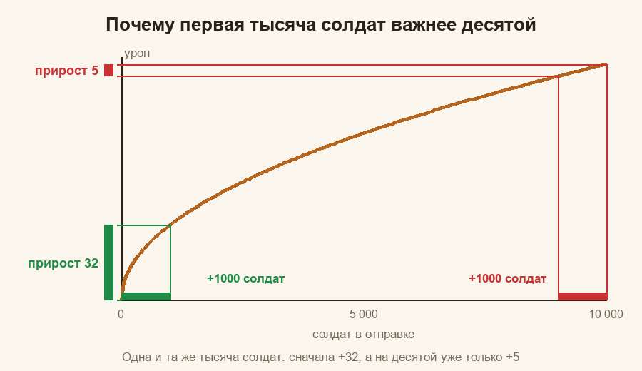
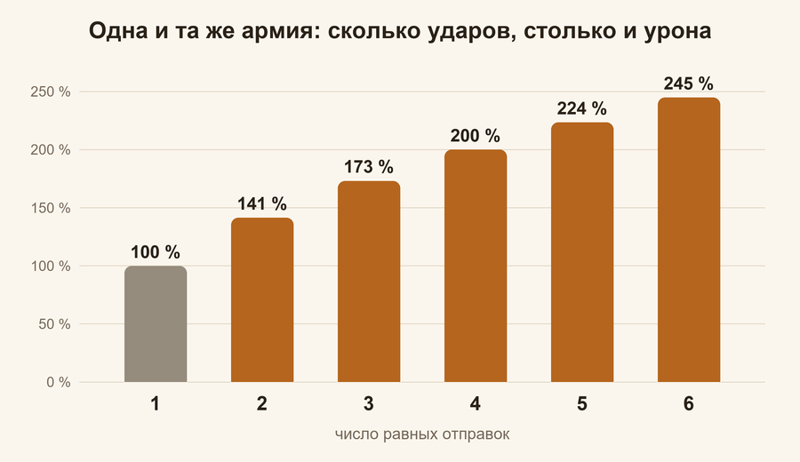

# Охота на медведя: почему так

**Гайды:** [Главная](../README.md) · [Памятка](../01-pamyatka/guide.md) · [Простыми словами](../02-prostymi-slovami/guide.md) · Почему так (вы здесь) · [Математика](../04-matematika/guide.md)

*Здесь мы открываем капот: откуда берутся правила из «Памятки». Математики ровно столько, сколько было в школе: корень, процент и умножение. Если корень вы забыли, он всё равно вернётся: такова его природа.*

## Что нужно вспомнить из школы

Всего четыре вещи, и ни одна не кусается.

1. **Квадратный корень.** `√100 = 10`, `√25 = 5`, `√4 = 2`. Корень из числа вдвое большего — это не вдвое больше, а примерно в **1,41** раза больше (`√2 ≈ 1,41`). Запомните эту странную дробь, она нас ещё выручит.
2. **Процент как множитель.** «+25 %» означает «умножить на 1,25». «+100 %» — умножить на 2. Проценты в игре почти всегда именно так и работают.
3. **Умножение vs сложение.** Если бонус **прибавляется** к другому, мы складываем проценты. Если бонусы **перемножаются**, складывать нельзя: надо перемножать множители. Разница бывает заметной.
4. **Среднее ожидание.** Если в половине случаев вы получаете +50 %, то «в среднем» это +25 %. Лотерея, но с понятным средним.

## Из чего складывается урон

Каждый тип войск (пехота, кавалерия, стрелки) бьёт по медведю отдельно, и урон типа считается так:

`урон типа = √(число солдат) × отдача типа × уровень войск × множитель таблицы`

Что здесь что:

- **Число солдат** стоит под корнем. Из этого корня вырастает полдюжины правил из «Памятки».
- **Отдача типа:** во сколько раз один солдат этого типа бьёт слабее или сильнее стрелка при прочих равных. Откуда берётся число, читайте в разделе [«Откуда берутся числа отдачи и уровня»](#откуда-берутся-числа-отдачи-и-уровня).
- **Уровень войск:** Т9 принимаем за 1,00, каждый уровень ниже слабее примерно в 1,19 раза (там же объяснение).
- **Множитель таблицы** берётся из «Бонуса рейда»: у каждого типа свой, он зависит от атаки и смертоносности именно этого типа.

**Внутри одного типа всё перемножается.** Урон разных типов не перемножается, а **складывается**: кавалерия бьёт сама по себе, стрелки сами по себе. (Если бы типы перемножались, армия без пехоты била бы ровно на ноль.) Дальше сумма умножается на множитель навыков, один на всех:

`урон участника = (урон пехоты + урон кавалерии + урон стрелков) × множитель навыков`

Множитель навыков складывается из навыков героев капитана и четырёх навыков присоединившихся (подробно ниже). **Цифры из таблицы и навыки героев не складываются между собой:** это два разных множителя, которые перемножаются. «+25 % смертоносности» от навыка не прибавляется к смертоносности из таблицы, а умножает весь результат. **Армия у вас с собой, а множители рейда выбираете вы**, когда решаете, в какой рейд идти. Все формулы на одной картинке, с числами одного рейда, смотрите в конце: [«Всё вместе: карта урона»](#всё-вместе-карта-урона).

## Откуда берутся числа отдачи и уровня

В карточке войск («Конный двор», «Казармы», «Стрельбище») у каждого уровня есть **Атака** и **Смертоносность** одного солдата. Вот кавалерия:

| Уровень | Атака | Смертоносность | Атака × смертоносность | Во сколько раз больше предыдущего |
|---|---|---|---|---|
| Т7 | 10 | 11 | 110 | |
| Т8 | 11 | 12 | 132 | 1,20 |
| Т9 | 12 | 13 | 156 | 1,18 |

Урон солдата растёт вместе с произведением «атака × смертоносность». У стрелков и кавалерии шаг между соседними уровнями получается 1,17–1,20, а реальные рейды дают в среднем **1,19**: это и есть «каждый уровень ниже слабее в 1,19 раза». (Полные таблицы по всем типам и уровням, с проверкой, лежат в «Математике»: [«Уровни войск и отдача типов»](../04-matematika/guide.md#4-уровни-войск-и-отдача-типов).) У пехоты по карточкам шаг больше (1,27–1,31), но пехоты в составах мало, и отдельно мы это не проверяли.

**А отдача типа?** Здесь мы оценили её тремя способами. Они сходятся по порядку (стрелок сильнее кавалериста, а тот сильнее пехотинца), но чуть расходятся по размеру:

| Откуда оценка | Стрелок | Кавалерист | Пехотинец | Ошибка прогноза на 35 рейдах |
|---|---|---|---|---|
| Наши измерения по настоящим рейдам | 1,00 | 0,59 | 0,27 | 2,0 % |
| Публичный калькулятор урона по медведю | 1,00 | 0,62 | 0,21 | 2,3 % |
| Карточки войск: атака × смертоносность Т9 (182 : 156 : 81), стрелкам +10 % за «Дальний удар» | 1,00 | 0,78 | 0,40 | 2,9 % |

Лучше всего с рейдами сходятся наши измерения, поэтому в расчётах стоят они. **Откуда именно такое отношение, мы не знаем:** формулу боя игра не показывает, а в карточке виден не весь набор того, что влияет на урон. Зато важно другое: **какая бы оценка ни была верной, состав «5 % пехоты, 25 % кавалерии, остальное стрелки» теряет не больше 1–2 % урона** (расчёт в разделе про состав и в «Математике»). Параметр «Сила» из карточки (50 у Т9) в расчёте не участвует.

## Почему много ударов лучше одного

Возьмём простой пример: 10 000 солдат одного типа и одного уровня.

- Одним маршем: `√10 000 = 100` очков урона (условных).
- Двумя маршами по 5 000: каждый даёт `√5 000 ≈ 70,7`, вместе `2 × 70,7 ≈ 141`.

Одна и та же армия, а результат больше на 41 %. Не колдовство: корень «растёт всё медленнее». Первая тысяча солдат даёт +32, а десятая только +5. Каждая следующая тысяча толкается в той же куче всё сильнее. Как в лифте в час пик.

Если разбить армию на `k` равных частей, каждая часть даёт `√(N/k)`, а вместе `k × √(N/k) = √k × √N`. То есть урон растёт в `√k` раз:

| Равных отправок | 1 | 2 | 3 | 4 | 5 | 6 |
|---|---|---|---|---|---|---|
| Урон, % от одного удара | 100 | 141 | 173 | 200 | 224 | 245 |

**Вывод:** отправляйте всё и делите на равные части. Равные потому, что корень «любит» ровность: две части по 5 000 лучше, чем 9 000 и 1 000 (`√9000 + √1000 ≈ 95 + 32 = 127` против 141).

### А если рейды разной мощности

Предположим, один рейд мощнее другого в 1,5 раза (мощность рейда — его итоговый множитель: таблица и навыки вместе). Тогда делить поровну уже невыгодно: в более мощный стоит отправить больше. Правило такое: **доля армии пропорциональна квадрату мощности рейда.** Для рейдов 1 и 1,5 это `1² : 1,5² = 1 : 2,25`, то есть 31 % и 69 %. Выигрыш против равного деления около 2 %: поэтому из-за небольшой разницы не мучайтесь. Если разница в разы, тогда да, мощному побольше.

## Почему 5 % пехоты и 25 % кавалерии

Один солдат у разных типов даёт разный урон. Если взять стрелка за единицу, то (при одинаковых бонусах рейда):

| Тип | Отдача одного солдата (из данных рейдов) |
|---|---|
| Стрелок | 1,00 |
| Кавалерист | 0,59 |
| Пехотинец | 0,27 |

Казалось бы: берём одних стрелков, они отдают больше всех. Звучит как надёжный план. Но число солдат стоит под корнем. Десятитысячный стрелок прибавляет почти ничего, а первый кавалерист прибавляет сразу и много. Где-то посередине выгоды выравниваются. Математика утверждает, что оптимальные доли **пропорциональны квадратам отдачи**:

| Тип | Отдача | Квадрат | Доля |
|---|---|---|---|
| Стрелки | 1,00 | 1,00 | 70 % |
| Кавалерия | 0,59 | 0,35 | 25 % |
| Пехота | 0,27 | 0,07 | 5 % |

Откуда проценты: 1,00 + 0,35 + 0,07 = 1,42, и дальше 1,00 / 1,42 ≈ 70 %, 0,35 / 1,42 ≈ 25 %, 0,07 / 1,42 ≈ 5 %.

Так получаются «5 % пехоты и 25 % кавалерии». Если у капитана кавалерия на 30 % слабее стрелков, её доля падает примерно до 14 %. Если на 30 % сильнее, растёт до 35 %. Отсюда правило из «Памятки»: «сравните бонусы кавалерии и стрелков».

### А если отдача типов на самом деле другая

Мы не знаем точной формулы боя, поэтому проверили: что будет, если окажется верной другая оценка отдачи (таблица выше). Лучший состав для каждой оценки и потеря урона от состава 5 / 25 / 70:

| Если верна оценка | Лучший состав (пехота / кавалерия / стрелки) | Потеря при 5 / 25 / 70 |
|---|---|---|
| наши измерения | 5 / 25 / 70 | 0 % |
| публичный калькулятор | 3 / 27 / 70 | 0,1 % |
| карточки войск (+10 % стрелкам) | 9 / 34 / 57 | 1,1 % |
| карточки войск без бонуса | 10 / 38 / 52 | 1,8 % |

Потеря не больше 1,8 %. Поэтому вопрос «какое число точнее» на практике почти ничего не меняет.

### Почему не нужна точность до солдата

Вершина кривой плоская. Если взять кавалерии вдвое меньше или вдвое больше, потеря невелика:

- Кавалерия от 15 до 35 %: теряете меньше 1 %.
- Пехота 3 % вместо 5 %: теряете около 0,15 %.
- **Совсем без пехоты и кавалерии:** одни стрелки теряют около 16 %. Ощутимо, и это самая дорогая ошибка.
- Пехоты 0 % при нормальной кавалерии: около −2,6 %.

Поэтому правило простое: не гонитесь за цифрами, берите «примерно столько» и не забывайте про пехоту и кавалерию. Линейка тут не понадобится.

## Почему слабые войска тоже стоит отправлять

Каждый уровень войск сильнее предыдущего примерно в **1,19** раза (откуда это число, смотрите в разделе про карточки выше): Т9 против Т8 на 19 % сильнее, Т8 против Т7 тоже. Пример: у вас 9 000 войск Т9 и 1 000 войск Т8.

- Только Т9: `√9000 × 1 = 94,9`.
- Все 10 000: средний уровень `(9000 × 1 + 1000 / 1,19) / 10 000 ≈ 0,984`, урон `√10 000 × 0,984 ≈ 98,4`.
- Если бы все 10 000 были Т9: 100.

Выходит, что слабые бойцы лишь на 1,6 % хуже идеала, а без них вы теряете 5 %. **Отправить лучше, чем оставить дома.** Пусть ветераны тоже подышат свежим воздухом.

### Почему переучивать выгоднее, чем набирать

Переучивание делает каждого солдата сильнее в 1,19 раза. А урон растёт как `уровень × √число`. Чтобы получить такой же результат, добавляя новых солдат, надо умножить их число на `1,19 × 1,19 = 1,42`: уровень входит в урон как есть, а число стоит под корнем, и чтобы корень дал те же 1,19, число придётся возводить в квадрат. Итого: переучивание на следующий уровень равно по эффекту прибавке около 40 % солдат.

Есть и второй довод, про время. Партия обучения или переобучения в лагере занимает одно и то же время (около 9,5 часа). В одном из городов за такую партию можно **обучить 653 бойцов Т9 или переучить 4 753 бойцов с Т8 на Т9**. У каждого города числа свои: они зависят от технологий и построек. А вот отношение примерно семь к одному одинаково, потому что скорость обучения действует на обучение и на переобучение одинаково. То есть за то же время вы переведёте на следующий уровень в семь раз больше бойцов, чем обучите новых. Вот почему в «Памятке» сначала переводим войска на высокий уровень и только потом обучаем новых.

## Атака и смертоносность: две стороны прямоугольника

Множитель таблицы для каждого типа войск считается так:

`множитель таблицы = (1 + атака) × (1 + смертоносность)`

Бонусы атаки и смертоносности **перемножаются**, как стороны прямоугольника. Пример: у рейда А атака 230 %, смертоносность 70 %. У рейда Б по 150 %. Суммы одинаковые (300 и 300), а множители разные:

- Рейд А: `3,3 × 1,7 = 5,61`
- Рейд Б: `2,5 × 2,5 = 6,25`

Ровный рейд сильнее перекошенного на 11 %.

**Следствие:** прибавка к **меньшей** стороне полезнее. Добавим +10 процентных пунктов рейду А:

- к смертоносности (+10): `3,3 × 1,8 = 5,94` (+5,9 %);
- к атаке (+10): `3,4 × 1,7 = 5,78` (+3,0 %).

Поэтому в «Памятке» написано «подтягивайте то, что меньше». Короткая сторона скромная, зато самая благодарная.

## Почему рейды сравнивают по смертоносности

В таблице капитана много строк, но пользоваться удобнее одной. У большинства капитанов атака отличается мало (допустим, 190 % и 200 %: это `2,9` против `3,0`, всего +3 %). А смертоносность отличается сильно (допустим, 70 % и 130 %: `1,7` против `2,3`, то есть +35 %). Различия в смертоносности и перевешивают.

Проверка простая: мы взяли 30 таблиц настоящих капитанов, посчитали точный урон, а потом упорядочили таблицы по одной «Смертоносности стрелков». Порядок совпал почти полностью (коэффициент ранговой корреляции 0,95). Поэтому можно сравнивать по одной строке. Остальные строки не обидятся.

Не забывайте: **навыки героев в таблице не отображаются.** Таблица показывает цифры капитана и блоки «Экспедиция» его героев (какие именно блоки, смотрите в разделе [«Блок «Экспедиция» в карточке героя»](../02-prostymi-slovami/guide.md#блок-экспедиция-в-карточке-героя)), а навыки смотрите отдельно: они меняют итог ещё в полтора-два раза (см. ниже).

## Навыки героев: сложение внутри, умножение снаружи

Походные навыки героев бывают трёх видов: на атаку, на смертоносность и «с шансом» (шанс усилить урон). Правило такое:

- Навыки **одного вида складываются** между собой.
- Суммы разных видов потом **перемножаются**.

`множитель навыков = (1 + прибавки атаки) × (1 + прибавки смертоносности) × (1 + средние прибавки «с шансом»)`

Пример: у капитана два навыка на атаку (+25 % и +25 %) и один на смертоносность (+25 %). Тогда:

`(1 + 0,25 + 0,25) × (1 + 0,25) = 1,5 × 1,25 = 1,875`

Такой рейд бьёт почти вдвое сильнее, чем рейд без навыков. Напомним: к цифрам из таблицы эти бонусы не прибавляются, а умножают весь результат.

### Навыки «с шансом»

Навык вроде «с шансом 50 % войска наносят на 50 % больше урона» в среднем даёт `0,5 × 0,5 = +25 %`. Несколько таких навыков складываются между собой: два по +25 % в среднем дают `1 + 0,25 + 0,25 = 1,5`. Если в рейде есть и они, и обычные навыки, итог получается умножением, например `1,875 × 1,25 = 2,34` с одним «шансовым» навыком Куинна.

В каждом конкретном рейде действует случай: два одинаковых рейда могут отличаться на 6–9 %, и это нормально. Удача — дама капризная даже на охоте. По данным рейдов такая простая модель («средняя прибавка = шанс × прибавка», без поправочных коэффициентов) работает не хуже, чем более хитрые варианты: разница в точности статистически незаметна.

## Четыре места присоединившихся и почему важно, кого поставить

В рейде четыре места под навыки присоединившихся, и ещё раз: занимают их навыки с самым высоким уровнем, а не самые полезные. Их вклад в урон считается тем же правилом «складываем внутри, перемножаем снаружи».

Пример. У капитана один навык атаки и один смертоносности (по +25 %): базовый множитель `1,25 × 1,25 = 1,5625`. Теперь в рейд пришла Ченко (смертоносность +25 %). Тогда:

`1,25 × (1 + 0,25 + 0,25) = 1,25 × 1,5 = 1,875`

Рост урона рейда: `1,875 / 1,5625 = 1,2`, то есть на 20 %.

Ещё три такие же прибавки к смертоносности дадут:

| Что стоит в четырёх местах | Рост урона рейда |
|---|---|
| одна Ченко/Ёну | ×1,20 |
| две Ченко/Ёну | ×1,40 |
| три Ченко/Ёну | ×1,60 |
| четыре Ченко/Ёну | ×1,80 |
| **две Ченко/Ёну + две Амане** | **×1,96** |

**Прибавка линейная?** Да, если считать от рейда без присоединившихся: +20 %, +40 %, +60 %, +80 %, потому что каждая новая смертоносность добавляет к сумме по 0,25, то есть к исходным 1,25 по одной пятой. Если же считать от предыдущего шага, прибавка слегка тает: ×1,20, затем ×1,17, затем ×1,14, затем ×1,125.

**Почему две плюс две лучше, чем четыре одинаковых?** Сумма внутри вида растёт на одно и то же число, а общий результат умножается: четыре смертоносности дают `1,25 × 2,25 = 2,81`, а две плюс две атаки дают `1,75 × 1,75 = 3,06`. Рассуждение то же, что с прямоугольником: ровные стороны выгоднее.

Навык 4 уровня вместо 5 даёт не +25 %, а +20 %. Если все четыре навыка лучшей четвёрки на 4 уровне, рейд получает `1,74` вместо `1,96`, то есть на 11 % меньше. Прокачка одного навыка на уровень вверх приносит очки всему рейду. Редкий случай, когда ваша прокачка радует не только вас.

### Какой набор навыков нужен именно этому рейду

**Набор «две смертоносности и две атаки» не универсален.** Он лучший, когда у капитана суммы навыков атаки и смертоносности примерно равны. В общем случае цель одна: выровнять две суммы. **Добавляйте навык того вида, где сумма сейчас меньше.**

Пример. У капитана навыки атаки дают +50 %, смертоносности +25 %. Базовый множитель `1,5 × 1,25 = 1,875`. Присоединяется:

- Ченко (смертоносность +25 %): `1,5 × 1,5 = 2,25`, рост ×1,20;
- Амане (атака +25 %): `1,75 × 1,25 = 2,19`, рост ×1,17.

Выигрывает Ченко, потому что смертоносность была слабее. Так что набор для каждого рейда свой, и подсказка к нему лежит на виду: навыки капитана и четыре места присоединившихся.

Важное уточнение: **цифры атаки и смертоносности в таблице капитана тут ни при чём.** Таблица образует свой множитель (первая скобка), а навыки образуют свой, отдельный. Если у капитана в таблице смертоносность проседает, четыре смертоносности из навыков её «не подтянут», а лишь сделают отдельный множитель более перекошенным. Выравнивать надо суммы внутри навыков. (Это следует из модели, которая в среднем ошибается на 2 %; прямой проверки «таблица и навыки действуют вместе» мы не делали.)

## Как выбрать героя капитана

Сравнивать героев по цифрам, которые они дают стрелкам в таблице, нечестно: эти цифры зависят от звёзд и уровня героя, а у каждого игрока они свои. Поэтому сравнивайте то, что можно оценить для любого героя:

1. **Навык.** Какого он вида (атака, смертоносность или «с шансом») и какого уровня. «+25 %» работает всегда, навык «с шансом» в среднем даёт столько же, но с разбросом.
2. **Эксклюзивное снаряжение героя редкости SSR.** У каждого такого героя оно своё и прибавляет что-то своему типу войск.
3. **Что рейду не хватает.** Прибавка весит больше там, где сумма меньше: +0,25 к сумме 1,0 даёт `×1,125`, а к сумме 3,0 только `×1,06`. То же с «шансовыми» навыками: каждый следующий добавляет меньше, чем предыдущий.
4. **Ваши звёзды и уровни.** После оценки пунктов 1–3 поставьте героев по очереди и посмотрите «Бонус рейда»: таблица с вашими звёздами покажет итог.

**Пример: Соул и Куинн** (оба стрелки). У Соула навык «+25 % смертоносности» (на 4 уровне +20 %) и эксклюзивное снаряжение «Кроличья пушка»: в показателях экспедиции она даёт смертоносность стрелков от +5 % (уровень +1) до **+50 %** (максимальный уровень +10). У Куинна навык «с шансом 50 % войска наносят на 50 % больше урона» (в среднем +25 %) и своё эксклюзивное снаряжение: смотрите его в карточке героя.

Чем хороша пушка в числах. Допустим, смертоносность стрелков из таблицы вместе с общей даёт `1 + 1,30 = 2,30`. Пушка прибавляет `0,50`:

`(1 + 1,30 + 0,50) / (1 + 1,30) = 2,80 / 2,30 ≈ 1,22`

Для стрелков это +22 %, а так как стрелки дают около 70 % урона, весь урон растёт примерно на 15 %. Прибавьте навык Соула, и аргумент в его пользу солидный, если пушка прокачана. Расчёт самого навыка (Соул против Куинна) с числами смотрите в «Математике»: [«Как выбрать героя: расчёт на примере»](../04-matematika/guide.md#8-как-выбрать-героя-расчёт-на-примере). Там видно и главное: исход зависит от того, что в рейде уже есть (например, сколько «шансовых» навыков стоит у других героев).

## Где у системы слепое пятно

Система отбирает навыки присоединившихся только по уровню. Она не знает, что защитный навык 5 уровня «хуже» полезного 4 уровня, просто сравнивает числа 5 и 4. Читать описания навыков она так и не научилась. Поэтому правило **«если полезного героя нет, поставьте первым героя с самым низким уровнем первого правого навыка»** работает как защита рейда: ваш бесполезный навык не вытеснит чужой полезный.

## Чего нет в формулах и почему

- **Защита и здоровье.** Медведь не отвечает, так что эти параметры нигде не появляются.
- **Блок «Завоевание».** Он влияет на героя в других боях, а в охоте на медведя герой лично не бьёт.
- **Порядок героев у капитана.** Таблица от порядка не зависит.
- **Герои 2 и 3 у присоединившегося.** Для рейда они не считаются: нужны только ради вместимости марша.

## Всё вместе: карта урона

Вся формула в одном выражении выглядит так:

`урон = ( √N_пех · b_пех · q_пех · A_пех + √N_кав · b_кав · q_кав · A_кав + √N_стр · b_стр · q_стр · A_стр ) × S`

где `N` — число солдат типа, `b` — отдача типа, `q` — уровень войск, `A` — множитель таблицы типа, `S` — множитель навыков. Каждый `A` и `S` сам раскладывается на скобки с атакой и смертоносностью. Чтобы не потеряться, посмотрите карту: на ней показан разбор одного рейда с числами, и видно, что складывается (синие плюсы), а что перемножается (оранжевые крестики).

Читать карту просто. Левая панель: три типа войск, внутри каждого четыре множителя, итоги типов складываются. Правая панель: навыки, внутри каждого вида складываем, виды перемножаем. Внизу слева видно, откуда берётся множитель таблицы. В конце обе части перемножаются. Числа этого рейда разобраны шаг за шагом в «Математике»: [«Разбор одного рейда»](../04-matematika/guide.md#9-разбор-одного-рейда).

## Насколько можно доверять цифрам

Формулы подобраны по данным настоящих рейдов и в среднем ошибаются примерно на 2 %. Большинство игроков попадает в эти 2 %. Это не точное знание «как устроена игра изнутри», а рабочая модель, и работает она хорошо.

Поэтому разницу меньше 2–3 % искать бессмысленно: она тонет в случайности (два одинаковых рейда расходятся на 6–9 %). Крупные решения (равные отправки, смертоносность, четыре места, переучивание) дают десятки процентов, их и надо делать первыми.

## Мини-проверка

Три задачки, чтобы закрепить. Ответы спрятаны: нажмите на замазанный текст, чтобы открыть.

1. Вы разбили армию на 3 равные отправки. Во сколько раз вырос урон по сравнению с одной отправкой? 

Ответ
В `√3 ≈ 1,73` раза.

2. Рейд А: атака 200 %, смертоносность 100 %. Рейд Б: 150 % и 150 %. Какой лучше и на сколько? 

Ответ
А даёт `3 × 2 = 6`, Б даёт `2,5 × 2,5 = 6,25`. Б лучше на 4 %.

3. Капитан имеет по одному навыку на атаку и смертоносность (по +25 %). Присоединилась Ченко (смертоносность +25 %). Во сколько раз вырос рейд? 

Ответ
Было `1,25 × 1,25 = 1,5625`, стало `1,25 × 1,5 = 1,875`; рост `1,875 / 1,5625 = 1,2`, то есть на 20 %.

Все формулы целиком, с выводом и проверкой, ждут в [«Математике»](../04-matematika/guide.md). Для тех, кому одного корня оказалось мало.
