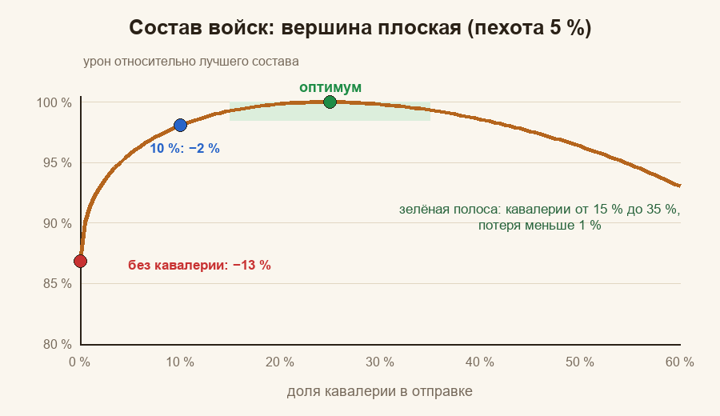
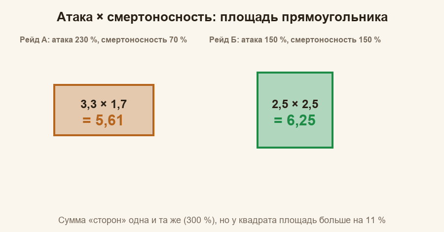
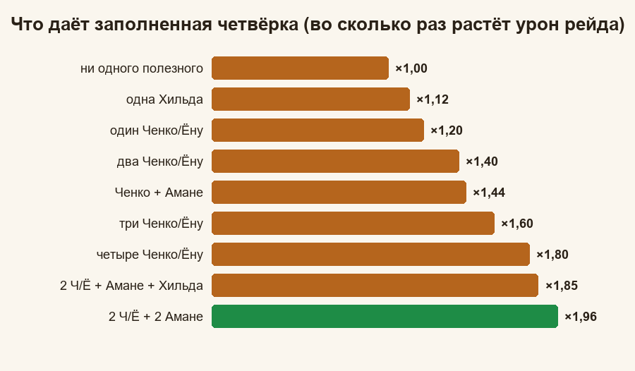

# Охота на медведя: математика

**Гайды:** [Главная](../README.md) · [Памятка](../01-pamyatka/guide.md) · [Простыми словами](../02-prostymi-slovami/guide.md) · [Почему так](../03-pochemu-tak/guide.md) · Математика (вы здесь)

*Последний уровень: формулы целиком, с выводом и числами. Уровень математики не выше девятого класса: корни, неравенство `(a − b)² ≥ 0`, проценты и таблицы. Если что-то непонятно, вернитесь в «Почему так»: там то же самое, но медленнее.*

## 0. Договоримся об обозначениях

| Символ | Что значит |
|---|---|
| `t` | тип войск: пехота (`inf`), кавалерия (`cav`), стрелки (`arc`) |
| `N_t` | число солдат типа `t` в отправке; `N = N_inf + N_cav + N_arc` |
| `b_t` | вес одного солдата типа `t` (на сколько он «сильнее» базового) |
| `q_t` | средняя сила уровней войск типа `t` (Т9 = 1) |
| `A_t` | множитель рейда для типа `t` из таблицы капитана (атака и смертоносность) |
| `S` | множитель навыков (капитана и четырёх присоединившихся) |
| `Σ` | знак суммы: `Σ_t` значит «сложить по трём типам» |
| `w_t` | собирательная «сила типа»: `w_t = b_t · q_t · A_t` |

Две оговорки. Во-первых, **форма** формул (корень, произведения, сложение внутри вида) проверена по данным настоящих рейдов, а **числа** внутри (`b_t`, шаг уровня, вес навыков с шансом) подобраны подгонкой и известны с погрешностью; погрешности указаны. Во-вторых, абсолютный масштаб урона нам не нужен: мы сравниваем варианты между собой, и общий множитель сокращается.

## 1. Модель урона участника

Урон одного участника рейда:

`D = K · Σ_t [ √(N_t) · b_t · q_t · A_t ] · S`

где `K` один и тот же для всех, а:

- `A_t = (1 + a_t + a_g) · (1 + l_t + l_g)`: **атака** `a_t` и **смертоносность** `l_t` типа плюс общие строки `a_g`, `l_g` из таблицы капитана (все величины в долях: 25 % = 0,25);
- `S = (1 + ΣA_нав) · (1 + ΣL_нав) · Π(1 + c·p·x)`: навыки атаки складываются, навыки смертоносности складываются, затем всё перемножается; последнее произведение относится к навыкам «с шансом» (см. п. 6);
- `q_t = Σ_L n_{t,L} · u^(L − 9) / N_t`: усреднение силы уровней, `u` — шаг уровня (п. 4).

Проверка структуры (на 12 игроках двух рейдов с известным составом): если брать корень **от числа войск каждого типа отдельно**, остаток модели около 1 %; если брать один корень от всей армии, остаток около 7 %; если брать корень по группам «тип × уровень», остаток 17–45 %. Поэтому в формуле корень стоит именно по типам.

Подобранные параметры (общая подгонка по 35 рейдам, 226 игрокам; остаток 1,74 %):

| Параметр | Значение | Допустимо |
|---|---|---|
| шаг уровня `u` (Т8→Т9, Т7→Т8 и т. д.) | 1,19 | 1,18–1,20 |
| вес стрелка `b_arc` | 4,4 | 4,0 × 1,1 («Дальний удар») |
| вес кавалериста `b_cav` | 2,6 | 2,3–2,9 |
| вес пехотинца `b_inf` | 1,2 | 0,8–1,4 |
| отношение кавалерист / стрелок `r` | 0,59 | |
| отношение пехотинец / стрелок `r_i` | 0,27 | 0,18–0,32 |
| вес навыков «с шансом» `c` | 0,75–0,85 | |

Вес пехоты определён хуже остальных: чистых «пехотных» отправок в данных почти нет.

## 2. Почему корень требует равных частей

### Лемма (две части)

Для любых неотрицательных `x` и `y`:

`(√x + √y)² ≤ 2 · (x + y)`

*Доказательство.* Раскроем скобки: `x + 2√(xy) + y ≤ 2x + 2y`. Перенесём всё в одну сторону: `0 ≤ x − 2√(xy) + y = (√x − √y)²`. Квадрат неотрицателен, неравенство верно. Равенство достигается только при `x = y`. ∎

Значит, разделив армию `N` на две части, максимум урона `√x + √y` получается при `x = y = N/2`, и равен `√(2N)`: ровно в `√2 ≈ 1,41` раза больше, чем одним ударом `√N`.

### Много частей

Разобьём армию на `k` равных частей. Урон каждой `√(N/k)`, всего

`k · √(N/k) = √k · √N`

То есть **урон растёт в `√k` раз**. Значения (с учётом того, что одна отправка = 100 %):

| `k` | 1 | 2 | 3 | 4 | 5 | 6 |
|---|---|---|---|---|---|---|
| `√k`, % | 100 | 141 | 173 | 200 | 224 | 245 |

Прирост от каждой следующей отправки уменьшается: от первой до второй +41 пункт, от пятой до шестой +21. Но он всегда положителен, поэтому армию лучше разбить на столько отправок, сколько позволяют марши.

### Рейды разной силы

Пусть отправки идут в рейды с множителями `m_1, m_2, …` и в отправку `i` уходит `N_i` солдат при `Σ N_i = N`. Нужно максимизировать `Σ m_i · √N_i`.

**Утверждение.** `Σ m_i · √N_i ≤ √(Σ m_i²) · √N`, и равенство достигается при `N_i` пропорциональных `m_i²`.

*Доказательство для двух частей* (обозначим их `x` и `y`): `(m_1² + m_2²)(x + y) − (m_1√x + m_2√y)² = m_1²y + m_2²x − 2m_1m_2√(xy) = (m_1√y − m_2√x)² ≥ 0`. Значит, `(m_1√x + m_2√y)² ≤ (m_1² + m_2²)(x + y)`, а равенство при `m_1√y = m_2√x`, то есть `y/x = m_2²/m_1²`. Для трёх частей разность правой и левой частей равна сумме трёх таких квадратов (по одному на каждую пару частей), и вывод тот же. ∎

**Пример.** Рейды силой 1 и 1,5. Доли армии: `1 : 2,25`, то есть 31 % и 69 %. Максимум `√(1 + 2,25) · √N = 1,803 √N`. Если делить поровну: `(1 + 1,5) · √(N/2) = 1,768 √N`. Потеря `1 − 1,768/1,803 ≈ 2 %`. Поэтому небольшую разницу в силе рейдов учитывать не стоит, а вот разница в два-три раза уже заметна.

## 3. Состав войск

### Оптимальные доли

Для одной отправки максимизируем `F = Σ_t w_t · √(N_t)` при `Σ N_t = N`.

**Утверждение.** `F ≤ √(Σ w_t²) · √N`, и максимум достигается при

`N_t = N · w_t² / Σ w²`.

Доказательство то же, что в разделе «Рейды разной силы» (там вместо `m_i` стоят `w_t`). Значит, **доля типа пропорциональна квадрату его силы**.

### Числа

Если у всех типов одинаковые множители рейда (`A_t` равны), берём `w_arc = 1`, `w_cav = r = 0,59`, `w_inf = r_i = 0,27`:

| Тип | `w` | `w²` | Доля, % |
|---|---|---|---|
| стрелки | 1,00 | 1,000 | 70,4 |
| кавалерия | 0,59 | 0,348 | 24,5 |
| пехота | 0,27 | 0,073 | 5,1 |
| **сумма** | | **1,421** | 100 |

Максимум `√1,421 = 1,192` от `√N`. Чистые стрелки дают `1,000`, то есть **на `1 − 1/1,192 ≈ 16 %` меньше**.

Если у капитана множитель кавалерии другой, `w_cav = 0,59 · A_cav / A_arc`:

| `A_cav / A_arc` | `w_cav` | стрелки | кавалерия | пехота |
|---|---|---|---|---|
| 0,7 | 0,41 | 80 % | 14 % | 6 % |
| 1,0 | 0,59 | 70 % | 25 % | 5 % |
| 1,3 | 0,77 | 60 % | 35 % | 4 % |

Пехота взята с `w = 0,27`.

### Насколько страшно промахнуться

Ценность состава относительно оптимума `V = F / F_max`. Считаем при `w = (1 ; 0,59 ; 0,27)`.

**Доля кавалерии при пехоте 5 %:**

| Кавалерия | 0 % | 10 % | 15 % | 20 % | **25 %** | 30 % | 35 % | 40 % | 50 % |
|---|---|---|---|---|---|---|---|---|---|
| `V`, % | 86,8 | 98,1 | 99,3 | 99,9 | **100** | 99,8 | 99,3 | 98,6 | 96,3 |

**Доля пехоты при кавалерии 24,5 %:**

| Пехота | **0 %** | 1 % | 2 % | 3 % | **5 %** | 10 % | 15 % | 20 % |
|---|---|---|---|---|---|---|---|---|
| `V`, % | 97,4 | 99,2 | 99,6 | 99,9 | **100** | 99,6 | 98,5 | 97,1 |

**Готовые составы:**

| Состав (пех / кав / стр) | `V`, % |
|---|---|
| 3 / 28 / 69 | 99,8 |
| 2 / 23 / 75 | 99,6 |
| 10 / 10 / 80 | 97,8 |
| 0 / 0 / 100 | 83,9 |

Почему вершина плоская: вблизи максимума потеря растёт как квадрат отклонения (в точке максимума любая гладкая кривая похожа на параболу). Отклонение в 10 п. п. даёт потерю порядка 0,7–1 %, а при 5 п. п. около 0,2 %. Зато «ноль» кавалерии или пехоты уводит далеко от вершины, потому что корень вблизи нуля растёт круче всего (это тот же эффект, что в «первая тысяча важнее десятой»).

## 4. Уровни войск

Сила `q` средняя по уровням: если у вас `n_L` солдат уровня `L` (IX = 9), то

`q = Σ_L n_L · u^(L − 9) / N`, `u = 1,19`

Например, 9 000 войск Т9 и 1 000 Т8 дают `q = (9000 + 1000/1,19)/10 000 = 0,984`.

### Отправлять ли слабых?

Сравним `N` сильных (сила 1) и `N` сильных плюс `Δ` слабых (сила `s < 1`):

`(N + sΔ)/√(N + Δ)` против `√N`.

Прирост есть, если `(N + sΔ)² > N(N + Δ)`, то есть `2Ns + s²Δ > N`, откуда при `Δ`, малом против `N`, получаем `s > 1/2`. **Добавлять слабый уровень выгодно, пока он не слабее примерно вдвое**: при шаге 1,19 для армии Т9 это даже Т5 (`1,19^(−4) ≈ 0,5`). Выгода уменьшается, но остаётся.

Пример: 9 000 Т9 + 1 000 Т8: все 10 000 дают `√10 000 · 0,984 = 98,4`; только Т9: `√9 000 = 94,9`; 10 000 Т9 было бы `100`. Слабая тысяча даёт +3,7 % к урону армии без неё (98,4 против 94,9).

### Переучить или обучить новых?

Переучивание на уровень выше умножает `q` на `u = 1,19`. Чтобы получить тот же прирост урона увеличением `N`, надо `√(N'/N) = 1,19`, то есть `N'/N = 1,19² = 1,416`: **около +42 % солдат**. При этом переучивание не требует лишних мест в марше.

## 5. Атака × смертоносность

`A = (1 + a)(1 + l)`, где `a`, `l` — суммарные атака и смертоносность типа (с общими строками), в долях.

### Ровное лучше перекошенного

Положим `p = 1 + a`, `q = 1 + l`. При фиксированной сумме `p + q` произведение наибольшее при `p = q`, потому что

`(p + q)² / 4 − pq = (p − q)² / 4 ≥ 0`.

Пример: атака 230 %, смертоносность 70 %: `3,3 × 1,7 = 5,61`; по 150 %: `2,5 × 2,5 = 6,25`. Разница `+11,4 %`.

### Куда добавлять

Если добавить `δ` к `p`, произведение вырастет на `δ · q`; если к `q`, то на `δ · p`. Значит, **выгоднее добавлять к той стороне, у которой «соседка» больше, то есть к меньшей стороне.** Пример с `p = 3,3`, `q = 1,7` и `δ = 0,1`: к `q` прибавка `0,1 · 3,3 = 0,33` (+5,9 %), к `p`: `0,1 · 1,7 = 0,17` (+3,0 %).

## 6. Навыки героев

Походные навыки капитана и первого героя присоединившегося:

- у героев-SSR три навыка, у SR и R два;
- атака и смертоносность растут на +5 % за уровень (до +25 % на пятом); у Хильды +3 % за уровень (до +15 %);
- **складываем внутри вида, перемножаем между видами**:

`S_тв = (1 + Σ прибавок атаки) · (1 + Σ прибавок смертоносности)`.

### Навыки «с шансом»

Если навык срабатывает с вероятностью `p` и усиливает урон на долю `x`, его вклад в среднем `(1 + p · x)`. Но по данным рейдов реальный вклад меньше: `(1 + c · p · x)` с `c ≈ 0,75–0,85` (причина кроется в деталях боевой механики; `c` определён из данных, а не выведен). Пример: Куинн, `p = 0,5`, `x = 0,5`:

| `c` | 0,5 | 0,75 | 1,0 |
|---|---|---|---|
| вклад | 1,125 | 1,19 | 1,25 |

В расчётах брали `c = 0,75`. Случайность тоже настоящая: у лучников есть «Залп» (шанс 10 %, что атака поражает дважды), и между рейдами с одинаковыми цифрами урон расходится на 6–9 %. Эта разница общая для **всех участников одного рейда**: в одном рейде у всех «повезло» или «не повезло» вместе.

## 7. Четыре места присоединившихся

**Правило отбора.** Берётся первый правый навык первого героя каждого присоединившегося, навыки сортируются по уровню, при равном уровне раньше зашедший выше (так принято в расчётах; точное правило равенства не проверено), верхние четыре начинают действовать. Пятый уровень закрепляется.

**Вклад четвёрки.** Пусть у капитана суммы атаки и смертоносности навыков `S_a`, `S_l`, а четвёрка присоединившихся добавляет `Σa` и `Σl`. Рост урона всего рейда:

`M = (1 + S_a + Σa)(1 + S_l + Σl) / ((1 + S_a)(1 + S_l))`

Положим `S_a = S_l = 0,25` (по одному навыку каждого вида на 5 уровне). Базовый множитель `1,25 × 1,25 = 1,5625`.

| В четырёх местах | `(1 + S_a + Σa)` | `(1 + S_l + Σl)` | Произведение | `M` |
|---|---|---|---|---|
| ничего полезного | 1,25 | 1,25 | 1,5625 | 1,00 |
| Хильда | 1,40 | 1,25 | 1,750 | 1,12 |
| Ченко (или Ёну) | 1,25 | 1,50 | 1,875 | 1,20 |
| два Ченко/Ёну | 1,25 | 1,75 | 2,1875 | 1,40 |
| Ченко + Амане | 1,50 | 1,50 | 2,250 | 1,44 |
| три Ченко/Ёну | 1,25 | 2,00 | 2,500 | 1,60 |
| четыре Ченко/Ёну | 1,25 | 2,25 | 2,8125 | 1,80 |
| два Ч/Ё + Амане + Хильда | 1,65 | 1,75 | 2,8875 | 1,85 |
| **два Ч/Ё + два Амане** | **1,75** | **1,75** | **3,0625** | **1,96** |
| то же, но все навыки на 4 уровне | 1,65 | 1,65 | 2,7225 | 1,74 |

Из таблицы видно два эффекта:

1. **Убывающая отдача внутри вида.** Первый Ченко даёт `1,50/1,25 = ×1,20`, второй `1,75/1,50 = ×1,17`, третий `2,00/1,75 = ×1,14`, четвёртый `×1,125`. Каждый следующий «разбавляется» всё большей суммой.
2. **Разные виды перемножаются.** Поэтому две атаки и две смертоносности (`×1,96`) лучше четырёх смертоносностей (`×1,80`): это та же история с прямоугольником.

Зависимость от капитана: чем больше навыков у самого капитана, тем меньше прибавка. Один Ченко при `S_l = 0` даёт `×1,25`, при `0,25` `×1,20`, при `0,5` `×1,17`.

## 8. Куинн или Соул

Сравнение двух героев-стрелков при одинаковом снаряжении (данные карточек «Экспедиция» и таблиц «Бонус войск» одного и того же рейда с каждым из героев):

| | Куинн | Соул | Разница |
|---|---|---|---|
| атака стрелков | +196,27 % | +181,42 % | −14,85 п. п. |
| смертоносность стрелков | +180,64 % | +185,64 % | +5,00 п. п. |
| навык | «с шансом» | +25 % смертоносности | |

Общие строки таблицы: атака войск `a_g = 0,423`, смертоносность войск `l_g = 0,295`.

**Шаг 1. Множитель стрелков `A_arc`:**

- Куинн: `(1 + 1,963 + 0,423)(1 + 1,806 + 0,295) = 3,386 × 3,101 = 10,50`
- Соул: `(1 + 1,814 + 0,423)(1 + 1,856 + 0,295) = 3,237 × 3,151 = 10,20`

Отношение `10,20 / 10,50 = 0,972`. Стрелки дают около 70 % урона, поэтому общий урон падает на `0,70 · 2,8 % ≈ 2,0 %`.

**Шаг 2. Множитель навыков `S`.** Допустим, у капитана навыки смертоносности дают `S_l = 0,20` (например, один Явель 4 уровня), в остальном навыки одинаковы. Тогда часть `S`, которая зависит от героя стрелков:

- с Куинном `(1 + S_l) · 1,1875 = 1,20 × 1,1875 = 1,425` (шансовый навык при `c = 0,75`);
- с Соулом `(1 + S_l + 0,25) = 1,45`;
- отношение `1,45 / 1,425 ≈ 1,018` в пользу Соула.

**Шаг 3. Итог.** `0,980 × 1,018 ≈ 0,998`. **Практически ничья.**

Зависимость от `c`: при `c = 0,5` итог `×1,05` в пользу Соула, при `c = 1,0` `×0,95` в пользу Куинна. А при малой сумме смертоносности у капитана Соул сильнее: те же `+0,25` к сумме `1,0` дают `×1,125`, а к сумме `3,0` только `×1,06`.

**Оговорка.** Сравнение сделано для одинаковых условий. Реальные герои различаются **звёздами** и **уровнем навыка**: у Соула 3 звезды и навык 4 уровня (+20 %) дадут меньше, чем в таблице, а Куинн с 4 звёздами и навыком 5 уровня выиграет. Подставляйте свои цифры из блока «Экспедиция» и из «Бонуса рейда»: арифметика та же.

## 9. Как сравнить два рейда

Для одной таблицы капитана множитель стрелков `A_arc` и общий множитель рейда определяются прежде всего смертоносностью: у капитанов атака отличается мало, а смертоносность в разы. В числах: атака `190 %` против `200 %` даёт `2,9` против `3,0` (разница 3,4 %), а смертоносность `70 %` против `130 %` даёт `1,7` против `2,3` (разница 35 %).

Проверка: для 30 таблиц реальных рейдов мы сравнили порядок по «Смертоносности стрелков» (с добавлением общей «Смертоносности войск») и порядок по точному расчёту. Коэффициент ранговой корреляции Спирмена `ρ = 0,95`. Для сравнения порядок по «силе» капитана (сумма очков его героев) даёт `ρ ≈ 0,5`: пользоваться им нельзя.

Ограничение: **навыки героев в таблицу не входят**, они вносят множитель `S`. Если у двух рейдов смертоносность почти одна, смотрите на навыки капитана и на четыре места присоединившихся.

## 10. Насколько точна модель

- Остаток модели (отношение предсказанного урона к фактическому): стандартное отклонение `1,74 %` на общей выборке.
- Около 85 % игроков укладываются в `±2 %`.
- Между рейдами с одинаковыми цифрами из-за случайности расхождение `6–9 %`, одно и то же для всех участников конкретного рейда.
- Значит, различия меньше 2–3 % в расчётах искать не нужно: они тонут в шуме.

### Что не проверено

- **Т10:** по карточкам войск шаг уровня Т9→Т10 примерно `+15 %` (стрелки), `+17 %` (кавалерия), `+24 %` (пехота), но в боях это не проверялось.
- **Вес пехоты** `b_inf` определён косвенно (`1,2 ± 0,2`).
- **Сложение или умножение** общей и типовой частей `A_t`: данные не различают, на выводы это не влияет.
- **Снаряжение героев:** смертоносность из снаряжения известна не для всех героев.

## 11. Задачи с решениями

**Задача 1.** Армия 20 000 солдат одного типа, четыре марша. Во сколько раз урон больше, чем одной отправкой?
*Решение:* `√4 = 2`.

**Задача 2.** Рейды силой 1, 2 и 3. Как разделить 14 000 солдат?
*Решение:* доли пропорциональны `1 : 4 : 9`, всего `14` частей: по 1 000, 4 000 и 9 000 солдат.

**Задача 3.** У капитана кавалерия на 30 % сильнее стрелков (`A_cav / A_arc = 1,3`). Какова оптимальная доля кавалерии при `r_i = 0,27`?
*Решение:* `w_cav = 0,59 × 1,3 = 0,767`, `w² = 0,588`; сумма `1 + 0,588 + 0,073 = 1,661`; доля `0,588 / 1,661 = 35 %`.

**Задача 4.** Рейд А: атака 250 %, смертоносность 30 %. Рейд Б: по 140 %. Суммы одинаковые (280). Кто сильнее?
*Решение:* А: `3,5 × 1,3 = 4,55`; Б: `2,4 × 2,4 = 5,76`. Рейд Б сильнее на 27 %: перекос дорого обходится.

**Задача 5.** Капитан: один навык атаки +25 % и один смертоносности +25 %. Присоединились Амане и Ёну (оба 5 уровня). Насколько вырос урон рейда?
*Решение:* `(1 + 0,25 + 0,25)(1 + 0,25 + 0,25) / 1,5625 = 2,25 / 1,5625 = 1,44`. На 44 %.

**Задача 6.** Армия: 6 000 Т9 и 4 000 Т8. Сколько «эквивалентных» Т9, и какова потеря против 10 000 Т9?
*Решение:* `q = (6000 + 4000/1,19)/10 000 = 0,936`, урон `0,936 × 100 = 93,6`: потеря 6,4 %.

## 12. Короткая шпаргалка формул

| Что | Формула |
|---|---|
| урон участника | `D = K · Σ_t √N_t · b_t · q_t · A_t · S` |
| множитель типа | `A_t = (1 + a_t + a_g)(1 + l_t + l_g)` |
| множитель навыков | `S = (1 + ΣA)(1 + ΣL) · Π(1 + c·p·x)` |
| `k` равных отправок | `√k` раз |
| рейды силой `m_i` | доли `∝ m_i²`, максимум `√(Σ m²) · √N` |
| состав | доли `∝ w_t²`, `w_t = b_t · q_t · A_t` |
| переучивание на уровень выше | `u² = 1,42` (≈ +42 % солдат) |
| четыре места | `M = (1 + S_a + Σa)(1 + S_l + Σl) / ((1 + S_a)(1 + S_l))` |

Если нашли в формулах ошибку, значит, медведь здесь ни при чём.
